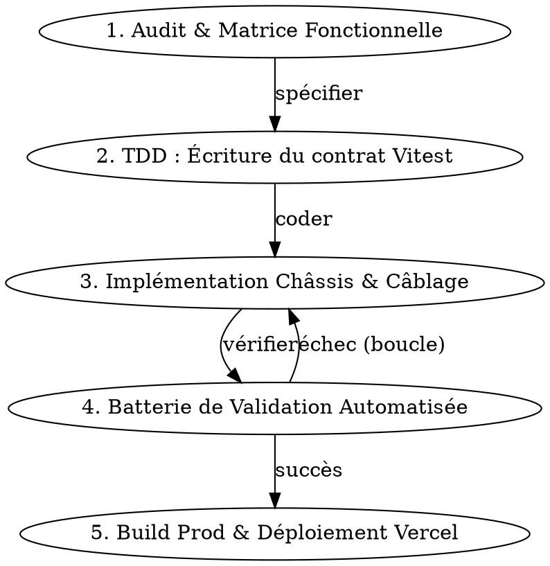

# LKDV iOS 27 Liquid Glass v15 — Skill de Refonte Universelle

Guide technique de référence pour décliner fidèlement le design et l'architecture de la **Page Compte iOS 27 Liquid Glass v15** sur toutes les pages de l'application (Clubs, Carnets, Groupes, Événements, etc.).

---

## 1. Invariants Absolus (Règles non négociables)

1. **Zéro modification dans `/compas`** : `src/app/compas/**` et `src/features/compas/**` ne doivent jamais être modifiés.
2. **Matériau Liquid Glass iOS 27 Clair exclusif** : Verre très translucide, bords lumineux, reflets internes, ombres teintées d'encre verte (`rgba(23,43,36,...)`), **jamais de `rgba(0,0,0)` brut en mode clair**, **aucun mode sombre**, **aucun aplat vert primaire `#17402C` plein sur les boutons des tiroirs**.
3. **Couleur orange proscrite** : Jamais de `#E4501C` nulle part.
4. **Sélecteurs compacts : Icônes pures** : Soit une icône SVG pure (19px), soit du texte pur ; jamais de mélange texte + icône dans les capsules compactes de tiroir ou de tab bar. `aria-label` et `aria-selected` / `aria-pressed` obligatoires.
5. **Drawers calés sur la Card (`syncCardBounds()`)** : Tout drawer en detent `"card"` et tout modal de détail immersif épousent **strictement** les coordonnées géométriques de la Card principale via les variables CSS `--card-*`.
6. **Sécurité d'identité en 2 étapes** : Tout profil auteur/membre passe obligatoirement par `fetchPublicProfilesWith(supabase, userIds)` (vue `public_profiles`). Jamais d'embed de clé étrangère risquant d'exposer des données privées.
7. **Échappement XSS systématique** : Dans le runtime DOM, toute chaîne injectée doit passer par `esc()`.
8. **Vérité des données** : Zéro métrique ou statistique inventée. Donnée absente = affichée absente ("non renseigné", "à confirmer").

---

## 2. Anatomie Détaillée Composant par Composant

### A. Châssis de Page & Grille 60/40

```html
<div class="phone" id="phone">
  <!-- Dynamic Island + Barre d'état -->
  <div class="status">...</div>
  <div class="island" id="island" data-s="idle">...</div>

  <!-- Zone Haute 60% : Card & navigation -->
  <div class="top" id="top">
    <div class="head">...</div>
    <div class="card cs" id="card">
      <div class="card-scroll" id="card_scroll">
        <!-- Header, Compteurs, Bio, Stories, Contenu tabulaire/grille -->
      </div>
      <!-- Sélecteur flottant superposé aux cartes/posts -->
      <div class="ig-tabs-float" id="ig_tabs_float">
        <div class="ig-tabs" role="tablist">
          <button role="tab" aria-selected="true" data-a="tab" data-v="0">...</button>
          <button role="tab" aria-selected="false" data-a="tab" data-v="1">...</button>
          <span class="ig-th"></span>
        </div>
      </div>
    </div>
  </div>

  <!-- Zone Basse 40% : Carte 3D vivante -->
  <div class="mapzone" id="mapzone">
    <div class="map" id="map"></div>
    <button class="mgrab" data-a="mapbig" aria-label="Agrandir la carte"><span></span></button>
    <div class="mctl" id="mctl">...</div>
  </div>

  <!-- Tiroirs (Drawers) -->
  <div class="sw-wrap" id="sw" data-det="closed">
    <div class="scrim" data-a="close"></div>
    <div class="sheet" id="sheet" role="region" aria-modal="true" inert>
      <div class="grab" id="grab"><span></span></div>
      <div class="sh-h">...</div>
      <div class="sh-b" id="sh_b">...</div>
      <div class="sh-f" id="sh_f">...</div>
    </div>
  </div>
</div>
```

#### Règles CSS Châssis :
- `.phone` : Largeur 390px, hauteur 844px, `border-radius: 54px`, `overflow: hidden`, `display: grid; grid-template-rows: calc(60% - 49px) 1fr`.
- `.phone.mapbig` : `grid-template-rows: 172px 1fr`, transition fluide `0.55s cubic-bezier(.32,.72,0,1)`.
- `#card.cs` : `position: relative`, `overflow: hidden`, `border-radius: 26px`, matériau `.cs`.
- `#card.cs > .card-scroll` : **Seule couche scrollable**, `padding: 8px 12px 56px`, `overflow-y: auto`, `overscroll-behavior: contain`, `scroll-padding-bottom: 56px`, scrollbar masquée.

---

### B. Le Sélecteur Flottant Superposé (`.ig-tabs-float`)

Le sélecteur d'onglets principal ne pousse pas le contenu : il **flotte au-dessus du contenu** en bas à droite de la card.

```css
.ig-tabs-float {
  position: absolute !important;
  right: 10px !important;
  bottom: 10px !important;
  z-index: 12 !important;
  display: flex !important;
  align-items: flex-end !important;
  justify-content: flex-end !important;
  pointer-events: none !important;
}
.ig-tabs-float::before {
  content: "" !important;
  position: absolute !important;
  inset: -18px -10px -10px -20px !important;
  border-radius: 999px !important;
  background: radial-gradient(ellipse at center, rgba(255, 255, 255, 0.5), rgba(255, 255, 255, 0) 72%) !important;
  filter: blur(6px) !important;
  pointer-events: none !important;
  z-index: -1 !important;
}
.ig-tabs-float .ig-tabs {
  pointer-events: auto !important;
  width: 88px !important;
  height: 30px !important;
  border-radius: 999px !important;
  background: rgba(255, 255, 255, 0.65) !important;
  background-image: linear-gradient(180deg, rgba(255, 255, 255, 0.72), rgba(255, 255, 255, 0.42) 55%, rgba(255, 255, 255, 0.52)) !important;
  -webkit-backdrop-filter: blur(28px) saturate(180%) brightness(1.04) !important;
  backdrop-filter: blur(28px) saturate(180%) brightness(1.04) !important;
  border: 0.5px solid rgba(255, 255, 255, 0.8) !important;
  box-shadow: inset 0 1px 0 rgba(255, 255, 255, 0.95), inset 0 -1px 1px rgba(255, 255, 255, 0.45), 0 0 0 0.5px rgba(23, 43, 36, 0.14), 0 8px 22px rgba(23, 43, 36, 0.12) !important;
  display: grid;
  grid-auto-flow: column;
  grid-auto-columns: 1fr;
  padding: 2px;
  position: relative;
}
.ig-tabs-float .ig-tabs .ig-th {
  position: absolute;
  top: 2px;
  bottom: 2px;
  left: 2px;
  border-radius: 999px;
  background: linear-gradient(180deg, rgba(255, 255, 255, 0.5), rgba(255, 255, 255, 0.22)) !important;
  box-shadow: inset 0 1px 0 rgba(255, 255, 255, 0.95), inset 0 -1px 1px rgba(255, 255, 255, 0.4), 0 0 0 0.5px rgba(23, 43, 36, 0.06) !important;
  transition: transform 0.45s cubic-bezier(0.3, 1.3, 0.4, 1);
}
```

- **Calcul dynamique de la hauteur (`positionIgTabsFloat()`)** :
  Le `bottom` est ajusté dynamiquement pour se poser 10px au-dessus de la fin réelle du contenu de la card, évitant de masquer les dernières lignes.

---

### C. Les Drawers & Sous-Drawers (`.sheet`)

Tout drawer ouvert se cale en detent `"card"` en épousant les dimensions exactes de la card du haut.

```css
/* Calage au pixel sur la card */
.sw-wrap[data-det="card"] .sheet,
.post-modal-instagram {
  top: var(--card-top, 48px) !important;
  left: var(--card-left, 8px) !important;
  right: var(--card-right, 8px) !important;
  bottom: var(--card-bottom, 60px) !important;
  border-radius: var(--card-radius, 24px) !important;
  width: auto !important;
  max-width: none !important;
}

/* Verre translucide officiel du drawer */
.sheet {
  background:
    linear-gradient(180deg,
      rgba(255, 255, 255, calc(var(--ga, 0.3) + 0.70)),
      rgba(255, 255, 255, calc(var(--ga, 0.3) + 0.64)) 46%,
      rgba(255, 255, 255, calc(var(--ga, 0.3) + 0.68))) !important;
  -webkit-backdrop-filter: blur(calc(var(--gb, 14px) + 18px)) saturate(1.85) brightness(1.05) !important;
  backdrop-filter: blur(calc(var(--gb, 14px) + 18px)) saturate(1.85) brightness(1.05) !important;
  border: 0.5px solid rgba(255, 255, 255, 0.8) !important;
  box-shadow:
    inset 0 1.5px 0 rgba(255, 255, 255, 0.95),
    inset 0 -1px 1px rgba(255, 255, 255, 0.5),
    inset 0 0 22px rgba(255, 255, 255, 0.18),
    0 0 0 0.5px rgba(23, 43, 36, 0.12),
    0 -8px 36px rgba(23, 43, 36, 0.16) !important;
}

/* Cartes et lignes à l'intérieur du drawer */
.sheet .li.nt,
.sheet .reseau-user-row,
.sheet .oc {
  background: rgba(255, 255, 255, 0.82) !important;
  border-color: rgba(255, 255, 255, 0.7) !important;
}
.sheet .apple-grouped-card {
  background: rgba(255, 255, 255, 0.52) !important;
  border-color: rgba(255, 255, 255, 0.62) !important;
}
.sheet .reseau-toggle-wrap .apple-grouped-card {
  background: transparent !important;
  border: 0 !important;
  box-shadow: none !important;
}

/* Boutons d'action dans le drawer : JAMAIS d'aplat vert plein */
.sheet .reseau-btn.primary {
  background: var(--pg) !important;
  color: var(--pg-ink) !important;
  box-shadow: var(--pg-sh) !important;
}
.sheet .reseau-btn.active {
  background: rgba(255, 255, 255, 0.62) !important;
  color: #17402C !important;
  box-shadow: inset 0 1px 0 rgba(255, 255, 255, 0.9) !important;
}
```

- **Mécanique `syncCardBounds()`** :
  ```javascript
  const syncCardBounds = function() {
    const phone = $("phone"), card = $("card");
    if (!phone || !card) return;
    const p = phone.getBoundingClientRect(), c = card.getBoundingClientRect(), s = G.sc || 1;
    if (!c.width || !c.height) return;
    phone.style.setProperty("--card-top", ((c.top - p.top) / s).toFixed(2) + "px");
    phone.style.setProperty("--card-left", ((c.left - p.left) / s).toFixed(2) + "px");
    phone.style.setProperty("--card-right", ((p.right - c.right) / s).toFixed(2) + "px");
    phone.style.setProperty("--card-bottom", ((p.bottom - c.bottom) / s).toFixed(2) + "px");
    phone.style.setProperty("--card-radius", (getComputedStyle(card).borderRadius.split(" ")[0] || "24px"));
    positionIgTabsFloat();
  };
  ```
- **Cycle de vie du Drawer** :
  1. `openSheet(key, tabIndex, detent = "card")` : capture `sheetOpener = document.activeElement`, normalise `det = "card"`, exécute `syncCardBounds()`, replie la tab bar (`phone.classList.add("tabmin")`).
  2. Rendu de `sheet.inert = false`, focus déplacé vers le bouton fermer `[data-a="close"]`.
  3. À la fermeture : `sheet.inert = true`, retrait de `tabmin`, restauration automatique du focus sur `sheetOpener`.

---

### D. Sélecteurs Universels de Tiroir (`.flow`, `.segc`, `.reseau-toggle`, `.ig-sub`)

Règle stricte : **Icônes 19px uniquement**, aucune mention textuelle visible dans les boutons.

```css
.flow,
.segc,
.reseau-toggle,
.ig-sub {
  position: relative !important;
  height: 30px !important;
  border-radius: 999px !important;
  background: rgba(255, 255, 255, 0.65) !important;
  background-image: linear-gradient(180deg, rgba(255, 255, 255, 0.72), rgba(255, 255, 255, 0.42) 55%, rgba(255, 255, 255, 0.52)) !important;
  -webkit-backdrop-filter: blur(28px) saturate(180%) brightness(1.04) !important;
  backdrop-filter: blur(28px) saturate(180%) brightness(1.04) !important;
  border: 0.5px solid rgba(255, 255, 255, 0.8) !important;
  box-shadow: inset 0 1px 0 rgba(255, 255, 255, 0.95), inset 0 -1px 1px rgba(255, 255, 255, 0.45), 0 0 0 0.5px rgba(23, 43, 36, 0.14), 0 8px 22px rgba(23, 43, 36, 0.12) !important;
  display: grid !important;
  grid-auto-flow: column !important;
  grid-auto-columns: 1fr !important;
  padding: 2px !important;
}
.flow button,
.segc button,
.reseau-toggle button,
.ig-sub button {
  position: relative;
  z-index: 2;
  border: 0;
  background: none;
  color: #17402C;
  cursor: pointer;
  border-radius: 999px;
  display: grid;
  place-items: center;
  padding: 0;
}
.sel-lens,
.segc .th {
  position: absolute;
  z-index: 1;
  top: 2px;
  bottom: 2px;
  left: 2px;
  border-radius: 999px;
  background: linear-gradient(180deg, rgba(255, 255, 255, 0.5), rgba(255, 255, 255, 0.22)) !important;
  box-shadow: inset 0 1px 0 rgba(255, 255, 255, 0.95), inset 0 -1px 1px rgba(255, 255, 255, 0.4), 0 0 0 0.5px rgba(23, 43, 36, 0.06) !important;
  transition: transform 0.45s cubic-bezier(0.3, 1.3, 0.4, 1);
}
```

- Chaque bouton d'onglet doit comporter :
  `aria-label="Nom de l'onglet"` et `aria-selected="true|false"` (ou `aria-pressed="true|false"`).

---

### E. Fiche de Détail Immersive / Modal Post Minimal (`.post-modal-instagram`)

Le modal de détail (utilisé pour les posts, et déclinable pour les fiches Club ou Carnet immersives) élimine tout panneau blanc superflue :

```html
<div class="post-modal-instagram" id="post_modal_instagram" role="dialog" aria-label="Détail immersif">
  <div class="pmi-dialog" id="pmi_dialog">
    <!-- Grabber de fermeture par glissement vers le bas -->
    <div class="pmi-grabber" aria-hidden="true"><span></span></div>

    <!-- Barre supérieure : pillule profil + bouton options ⋯ -->
    <div class="pmi-header pmi-topbar">
      <button class="pmi-profile-pill" data-a="closePostModal" aria-label="Fermer">
        
        <span class="pmi-profile-meta">
          <b>@handle_ou_nom</b>
          <small>Massif ou statut · Empreinte vérifiée</small>
        </span>
      </button>
      <button class="pmi-more-pill" data-a="openPostOptions" aria-label="Options">···</button>
    </div>

    <!-- Menu contextuel d'options (flottant) -->
    <div class="pmi-options-menu" id="pmi_options_menu" hidden>
      <button data-a="toggleSavePost">...</button>
      <button data-a="sharePost">...</button>
      <button data-a="copyPostLink">...</button>
      <button data-a="reportPost" class="pmi-report">...</button>
    </div>

    <!-- Zone Média Plein Cadre -->
    <div class="pmi-scroll-area">
      <div class="pmi-media">
        
        <!-- Pillule Actions bas-droite (Like, Commentaire, Partage) -->
        <div class="pmi-action-pill pmi-actions" role="group">
          <button class="pmi-pill-btn" data-a="toggleLikePost">...</button>
          <button class="pmi-pill-btn" data-a="openPostComments">...</button>
          <button class="pmi-pill-btn" data-a="sharePost">...</button>
        </div>
        <!-- Pillule Légende bas-gauche -->
        <div class="pmi-caption-pill">Titre ou légende courte</div>
      </div>
    </div>

    <!-- Barre de saisie compacte en bas -->
    <div class="pmi-comment-bar">
      <input class="pmi-input" type="text" placeholder="Ajouter un commentaire..." />
      <button class="pmi-submit-btn" aria-label="Envoyer">...</button>
    </div>
  </div>
</div>
```

- **Règle vitale** : `.pmi-content-glass { display: none !important; }`. Les commentaires ou discussions ne sont pas affichés en pavé blanc sous l'image, ils s'ouvrent dans un **drawer dédié** (`post_comments` ou `club_topics`) reprenant le même design que les autres tiroirs.

---

### F. Carte 3D MapLibre & Contrôles

- **Canvas 3D** :
  - Initialisé avec fond `#0b101b` pour éliminer tout flash blanc.
  - Relief terrain MapLibre 3D activé (DEM terrarium/quantized).
  - Écouteurs de resize et `ResizeObserver` sur `.map` avec appel `map.resize()`.
- **Contrôles Carte (`.mctl`, `.map-scale-selector`)** :
  - Reprennent **exactement** le verre du sélecteur (`rgba(255, 255, 255, 0.65)`, `blur(28px)`, bordure blanche).
  - État actif / pressé : lentille en verre doux `linear-gradient(180deg, rgba(255,255,255,0.5), rgba(255,255,255,0.22))`, texte/icône `#17402C`. Jamais d'aplat plein vert.
- **Téléportation & Dynamic Island** :
  - Sélection d'un élément (club, sortie, carnet) déclenche `map.flyTo({ center: [lng, lat], zoom: 12.5, pitch: 55, bearing: ... })`.
  - Notification brève dans l'île dynamique : `island(titre, sousTitre, false)`.

---

## 3. Tokens & Déclarations CSS Obligatoires (Copier-Coller de Référence)

Toute page doit injecter les tokens maîtres :

```css
.phone {
  --page: #F5F2EC;
  --on-page: #172B24;
  --muted-page: #56665D;
  --rule: #A6C1A0;
  --label: #172B24;
  --label2: #56665D;
  --label3: rgba(23, 43, 36, 0.44);
  --sep: rgba(23, 43, 36, 0.1);
  --fill: rgba(23, 43, 36, 0.09);
  --fill2: rgba(23, 43, 36, 0.06);
  --fill3: rgba(255, 255, 255, 0.62);
  --tint: #17402C;
  --tint-ink: #FFFFFF;
  --accent: #5B7F55;
  --subtle: #A6C1A0;
  --mint: #EBF2EC;
  --good: #3D7A52;
  --warn: #B98A2E;
  --warn-bg: #FBF1DC;
  --bad: #A8443A;
  --bad-bg: #F5DDD9;
  --info: #4B6B7C;
  --water: #3F93B8;
  --ga: 0.19;
  --gb: 7px;
  --la: 140deg;
  --pg: linear-gradient(180deg, rgba(255,255,255,0.62), rgba(255,255,255,0.16) 52%, rgba(255,255,255,0.3)), rgba(150,186,142,0.34);
  --pg-ink: #17402C;
  --pg-sh: inset 0 1px 0 rgba(255,255,255,0.95), inset 0 -1px 0 rgba(255,255,255,0.4), inset 0 0 0 0.6px rgba(255,255,255,0.5), 0 0 0 0.6px rgba(23,64,44,0.16), 0 5px 14px rgba(23,64,44,0.13);
  --soft: rgba(150, 186, 142, 0.28);
  --soft-line: rgba(91, 127, 85, 0.38);
}
```

---

## 4. Pipeline de Sécurité & Supabase

1. **Chargement des profils auteurs / participants** :
   ```typescript
   // OBLIGATOIRE : passer par la vue sécurisée public_profiles
   import { fetchPublicProfilesWith } from '@/lib/queries/publicProfilesCore';

   const authorProfiles = await fetchPublicProfilesWith(supabase, [
     ...items.map(it => it.author_id || it.user_id).filter(Boolean)
   ]);
   ```
2. **Protection XSS** :
   ```javascript
   const esc = (s) => String(s ?? '').replace(/[&<>"']/g, c => ({
     '&': '&amp;', '<': '&lt;', '>': '&gt;', '"': '&quot;', "'": '&#39;'
   }[c]));
   ```
3. **Contrôle d'autorisation pour les actions de modération / écriture** :
   - Vérifier côté serveur l'appartenance `club_members.role in ('admin', 'moderator')`.
   - Utiliser `auth.uid()` comme référence infalsifiable.

---

## 5. Workflow de Refonte d'une Page en 5 Étapes



1. **Inventaire Fonctionnel (2 min)** : Lister les états existants de la page (ex: `/clubs` : liste clubs, mes clubs, recherche, filtres catégories, création, détail avec discussions/membres/défis/agenda/modération).
2. **TDD Contractuel (Red)** : Créer `tests/design/<page>-refonte-v15.spec.ts` validant :
   - Structure `#card > .card-scroll` + `.ig-tabs-float`.
   - Présence de `syncCardBounds()` et des variables `--card-*`.
   - Verre `0.65` et `blur(28px)` sur les sélecteurs et contrôles.
   - Sélecteurs de tiroirs avec icônes pures et `aria-label`.
   - Absence d'aplat primaire `#17402C` plein dans les tiroirs.
   - 0 modification dans `src/app/compas/**`.
3. **Implémentation (Green)** : Créer le composant `<Page>LiquidGlassV8.tsx` et son runtime en réemployant les classes et motifs CSS établis.
4. **Validation Automatisée (< 60s)** :
   ```bash
   node --check src/components/<page>/<page>-liquid-glass-v8-runtime.js
   npx vitest run tests/design/<page>-refonte-v15.spec.ts
   npx vitest run tests/design/
   npm run type-check
   npm run verify:invariants
   ```
5. **Déploiement & Clôture** : `npm run build` → Commit `feat(<page>): refonte v15 liquid glass...` → Push `main` → Contrôle du déploiement Vercel.
