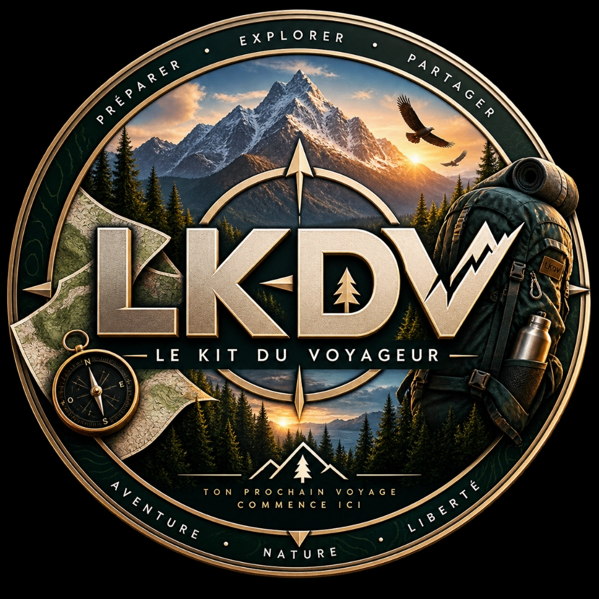

# Le Kit du Voyageur

### La super-app outdoor nouvelle génération — de la préparation au sommet, jusqu'au récit.

**Cartographie 3D · Science du Sport · Carnets & Clubs · Matériel 3D · Communauté**

---

## La Vision

Aujourd'hui, un aventurier, un randonneur ou un traileur doit jongler entre **six applications séparées et coûteuses** : une pour la carte, une pour le suivi sportif, une pour préparer son sac, une pour ses photos et récits, une pour son club et une messagerie pour organiser la sortie.

**Le Kit du Voyageur (LKDV)** réunit toute la vie outdoor dans **un seul écosystème fluide, natif et visuellement irréprochable**, conçu autour d'un cycle continu :

> **Préparer** son itinéraire et son sac → **Vivre** la sortie en sécurité et hors-ligne → **Analyser** sa performance avec une précision scientifique → **Partager** son récit, ses découvertes et son matériel avec sa communauté.

---

## L'Expérience Produit

<table>
  <tr>
    <td width="50%" valign="top">
      <h3>🗺️ Explorer 3D & Traceur Intégré</h3>
      

        Une carte 3D WebGL fluide à 60 FPS enrichie de dioramas 3D, de relief haute précision et des réseaux mondiaux de sentiers balisés (GR, rando, VTT, cyclo, ski). Tracez un itinéraire au doigt directement sur la carte, enregistrez votre sortie GPS même sans réseau et partagez votre position en direct avec vos proches.
      

    </td>
    <td width="50%" valign="top">
      <h3>📊 Studio d'Analyse Physiologique</h3>
      

        Dès la fin d'une sortie, un studio complet à 6 volets croise plus de <strong>20 moteurs scientifiques</strong> : allure ajustée à la pente (Minetti), charge d'entraînement (Banister CTL/ATL/TSB), détection d'ascensions Cat 1–5, prédictions de course, fatigue musculaire excentrique, stress thermique, hydratation et protocole de récupération 0–48 h.
      

    </td>
  </tr>
  <tr>
    <td width="50%" valign="top">
      <h3>📖 Carnets, Clubs & Communauté</h3>
      

        Chaque sortie terminée pré-remplit instantanément vos <strong>Carnets de voyage</strong>, <strong>Posts</strong>, <strong>Stories</strong> et <strong>Sorties de Club</strong> sans double saisie. Les Clubs disposent de leur propre carte 3D alpine synchronisée avec le fil, les événements, les salons de discussion et le coffre matériel partagé.
      

    </td>
    <td width="50%" valign="top">
      <h3>🎒 Kit Studio 3D, Matériel & Boutique</h3>
      

        Composez votre sac à dos en 3D, optimisez chaque gramme, suivez l'usure kilométrique de votre équipement sortie après sortie et accédez à une sélection matériel contextualisée à votre aventure — avec paiement intégré et programme de fidélité.
      

    </td>
  </tr>
  <tr>
    <td width="50%" valign="top">
      <h3>🌿 Pokédex Nature & Progression</h3>
      

        Identifiez et géolocalisez la faune et la flore rencontrées sur le terrain pour enrichir votre <strong>Pokédex Nature</strong>, débloquez des badges, relevez des défis de club et suivez votre progression d'explorateur.
      

    </td>
    <td width="50%" valign="top">
      <h3>✨ Design Apple Liquid Glass</h3>
      

        Une signature esthétique <strong>100 % Mode Clair Liquid Glass</strong> inspirée du papier et de la forêt : zéro noir agressif, priorité absolue au visuel et aux icônes, navigation tactile ultra-intuitive, mode haute lisibilité plein soleil et mode nocturne bivouac.
      

    </td>
  </tr>
</table>

---

## Pourquoi LKDV se Démarque (Thèse Technologique & Économique)

| Pilier | Avantage Stratégique LKDV |
| :--- | :--- |
| **Unit Economics Exceptionnels (`0 €` de coût data)** | Contrairement aux acteurs dépendants d'APIs cartographiques facturées à l'usage, LKDV s'appuie sur un pipeline 100 % open-data & edge (relief AWS Terrarium décodé côté edge, Waymarked Trails/OSM, Open-Meteo, éphémérides NOAA offline) et des calculs physiologiques/routage locaux en **Rust/WebAssembly**. |
| **Un Seul Socle · 3 Plateformes Natives** | Web/PWA sur **Cloudflare Workers**, application **iOS native** (Dynamic Island Live Activity, HealthKit, capteurs BLE) et **Android native** partagent une architecture unifiée — réduisant drastiquement le temps de développement et la maintenance. |
| **Effet Réseau & Rétention Naturelle** | Chaque sortie alimente simultanément la donnée personnelle (télémétrie, usure du sac, Pokédex) et la donnée sociale (Carnets, Clubs, Stories, Messagerie), créant une boucle de rétention organique forte. |
| **Monétisation Alignée avec l'Usage** | Commerce contextualisé au moment exact où l'utilisateur prépare son sac et mesure l'usure de son matériel, complété par l'écosystème Clubs, Pro et services avancés — sans publicité intrusive. |
| **Conçu pour le Terrain & la Confiance** | Fonctionnement **offline-first** en montagne (traces GPS, cartes, analyses locales), sécurité terrain (suivi en direct par lien sécurisé) et respect strict du **RGPD Art. 9** sur les données biométriques. |

---

## Chiffres Clés de la Plateforme

| **46** | **400+** | **20+** | **3** | **0 €** |
| :---: | :---: | :---: | :---: | :---: |
| Écrans & expériences produit | Endpoints API & services métier | Moteurs scientifiques & télémétrie | Plateformes (Web · iOS · Android) | Coût variable carto & open-data |

---

**Le Kit du Voyageur** — *Pensé pour ceux qui explorent le monde réel.*

Équipe technique & documentation interne : <a href="docs/README.md">Documentation complète</a>

