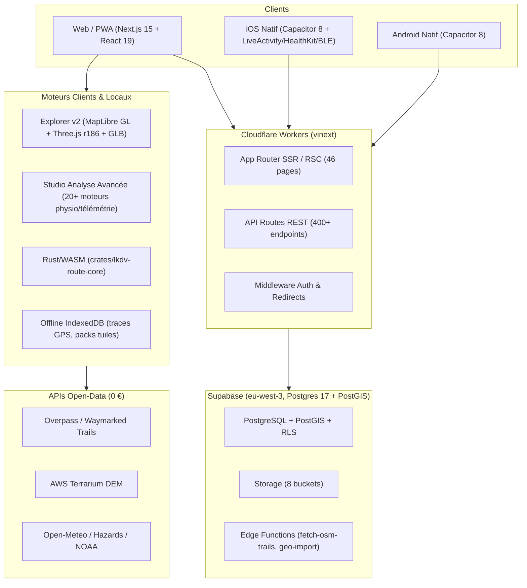

# Le Kit du Voyageur (LKDV)

**Plateforme outdoor, cartographie 3D, préparation d'expéditions, communauté et suivi de performance.**

Construit avec **Next.js 15 (App Router)**, **React 19**, **TypeScript**, **Supabase (PostgreSQL 17 + PostGIS)**, **MapLibre GL + Three.js r186**, **Cloudflare Workers (`vinext`)**, **Capacitor 8 (iOS & Android)** et un moteur de routage **Rust/WASM**.

---

## Architecture synthétique



---

## Démarrage rapide

```bash
# 1. Installer les dépendances
npm ci

# 2. Configurer les variables d'environnement locales
cp .env.example .env.local   # Renseigner NEXT_PUBLIC_SUPABASE_URL, ANON_KEY, SERVICE_ROLE_KEY

# 3. Vérifier la Design Bank (tokens CSS & presets Tailwind)
npm run design:check

# 4. Lancer le serveur de développement
npm run dev
```

### Commandes essentielles

| Action | Commande |
| :--- | :--- |
| Développement local | `npm run dev` (port `4000`) |
| Build production (Mac 8 Go RAM) | `FAST_BUILD=1 NODE_OPTIONS="--max-old-space-size=3072" npx next build` |
| Serveur production local | `npx next start -p 3001 -H ::` |
| Tests unitaires (Vitest) | `npm test` |
| Lint ESLint | `npm run lint` |
| Vérification Design Bank | `npm run design:check` |
| Synchronisation Mobile | `CAPACITOR_SERVER_URL=https://lekitduvoyageur.com npx cap sync` |

---

## Documentation complète (`docs/`)

Toute la documentation technique, produit, base de données, opérations et décisions d'architecture est centralisée dans **[docs/README.md](docs/README.md)** :

1. **[01 — Architecture globale](docs/01-architecture/ARCHITECTURE.md)** — Stack, App Router, Middleware, Cloudflare Workers (`vinext`), Capacitor iOS/Android, Rust/WASM.
2. **[02 — Base de données Supabase](docs/02-database-supabase/DATABASE.md)** — PostgreSQL 17 + PostGIS, ERD Mermaid, RLS, Storage, Edge Functions, Migrations.
3. **[03 — Routes & API REST](docs/03-api-routes/API_AND_ROUTES.md)** — Inventaire des 46 pages App Router et des namespaces API (`/api/*`).
4. **[04 — Explorer v2 & Cartographie GIS](docs/04-explorer-gis/EXPLORER_V2.md)** — MapLibre + Three.js r186, HUD 6 onglets, Waymarked Trails, Route Planner, Tracker GPS, Studio d'Analyse Avancée (6 volets / 20+ moteurs).
5. **[05 — Modules Produit](docs/05-modules-produit/MODULES.md)** — Communauté V2 & Handoff universel, Carnets `[id]`, Clubs & Sorties, Messagerie, Boutique & Kit Studio, Profil / Sac / Progression XP.
6. **[06 — Design System](docs/06-design-system/DESIGN_SYSTEM.md)** — Design Bank (`src/design/bank.ts`), Apple Liquid Glass, thèmes (`light` / `dark` / `night-red`), règles CSS portaled drawers.
7. **[07 — Opérations, Déploiement & Onboarding](docs/07-operations-deploy/OPERATIONS.md)** — Onboarding dev, env vars, contraintes RAM 8 Go, Cloudflare Workers, iOS/Android, CI/CD, Tests.
8. **[08 — Décisions (ADR) & Glossaire](docs/08-decisions-glossary/ADR_AND_GLOSSARY.md)** — Architecture Decision Records et glossaire métier/technique.

Pour les agents IA (Claude Code, Codex, Antigravity), consultez **[CLAUDE.md](CLAUDE.md)** et **[AGENTS.md](AGENTS.md)**.
