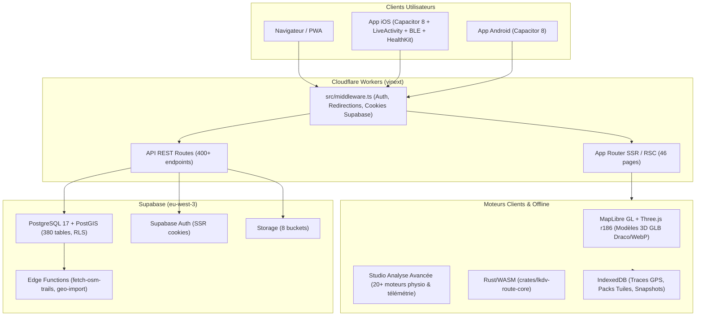

# 01 — Architecture Globale de Le Kit du Voyageur (LKDV)

## 1. Vue d'ensemble du système

**Le Kit du Voyageur (LKDV)** est une application hybride web/mobile construite sur une base **Next.js 15 App Router** compilée pour **Cloudflare Workers (`vinext`)** et embarquée en natif sur **iOS** et **Android** via **Capacitor 8**.



---

## 2. Stack Technique de Référence

| Couche | Technologie | Version / Détail |
| :--- | :--- | :--- |
| **Framework Web** | Next.js (App Router) + React | `15.5.25` / `19.3.1` |
| **Langage** | TypeScript | Strict (`tsconfig.json`) |
| **Hébergement Web** | Cloudflare Workers (`@vinext/cloudflare`) | `cloudflare.config.ts`, `vite.config.ts` (Vercel retiré) |
| **Mobile Natif** | Capacitor | `8.5.0` (`ios/`, `android/`, `.maestro/`) |
| **Base de données** | Supabase (PostgreSQL + PostGIS) | Postgres `17.6` (`eu-west-3`) |
| **Cartographie & 3D** | MapLibre GL + Three.js | `three` `r186`, GLB Draco+WebP |
| **Routage haute perf** | Rust / WebAssembly | `crates/lkdv-route-core` |
| **State & Data** | TanStack Query + IndexedDB | `@tanstack/react-query` `5.x` |
| **UI & Animation** | Tailwind CSS + Design Bank + Base UI + Framer Motion | `src/design/bank.ts`, `framer-motion` `12.x`, `recharts` `2.15` |
| **Paiements** | Stripe | `/panier`, `/checkout`, `/api/stripe`, `/api/orders` |

---

## 3. Flux Middleware & Routage (`src/middleware.ts`)

Le middleware intercepte uniquement les routes déclarées dans `config.matcher` :
1. **Rafraîchissement de session Supabase SSR** via `@supabase/ssr`.
2. **Protection des routes authentifiées** (`/compte/*`, `/hub/*`, `/messagerie`, `/profil`, `/admin/*`, etc.) → redirection `/connexion?next=...`.
3. **Redirections permanentes (`src/constants/routeRegistry.json`)** :
   - `/carnets` → `308` vers `/communaute` (seul `/carnets/[id]` est conservé).
   - `/itineraire` → redirigé vers `/explorer?mode=plan`.
   - `/explorer` est accessible librement (non bloqué par le middleware).

---

## 4. Architecture Cloudflare Workers (`vinext`)

- **Adaptation Edge** : `cloudflare.config.ts` et `vite.config.ts` (incluant `empty-stub.js` pour neutraliser les modules Node non supportés sur Workers).
- **Décodeur DEM pur JS** : Décodage PNG AWS Terrarium en pur JavaScript compatible Cloudflare Workers (sans dépendance native `sharp`/`canvas`).
- **Assets statiques** : Servis depuis `public/` (`assets/`, `models/`, `draco/`, `maplibre/`, `icons/`).

---

## 5. Architecture Mobile Native (Capacitor 8)

- **Configuration** : `capacitor.config.ts` impose `CAPACITOR_SERVER_URL` en `https://` pour toute build release (fail-closed : empêche de livrer un placeholder).
- **Plugins actifs** : `App`, `Camera`, `Geolocation`, `Haptics`, `Keyboard`, `Network`, `Preferences`, `SplashScreen`, `StatusBar`, `PushNotifications`.
- **Extensions iOS** (`ios/`) : Live Activity (Dynamic Island), HealthKit, BLE (capteurs cardiaques/cadence).
- **Tests E2E mobiles** : Scénarios Maestro dans `.maestro/`.

---

## 6. Crate Rust / WASM (`crates/lkdv-route-core`)

Calculs géométriques et de routage critiques exécutés côté client à vitesse quasi native sans coût serveur (`0 €`), utilisés pour le traitement de traces GPX, la simplification de polylignes et les calculs topographiques.

---

## 7. Arborescence Principale du Dépôt

```text
lkdv-reference/
├── src/
│   ├── app/                # 46 pages App Router + 400+ routes API (src/app/api/)
│   ├── components/         # Composants UI transverses (compte, groupes, map, ui, etc.)
│   ├── constants/          # routeRegistry.json et constantes métier
│   ├── design/             # Design Bank (bank.ts — source unique des tokens)
│   ├── features/           # Modules métier isolés (explorer-v2, community, clubs, hub, materiel, ...)
│   ├── lib/                # Utilitaires, clients Supabase, moteurs physio/calcul, i18n
│   ├── styles/             # explorer-glass.css, liquid-glass.css, tokens.css, tailwind.css
│   └── types/              # Déclarations TypeScript globales
├── crates/lkdv-route-core/ # Moteur Rust/WASM
├── supabase/               # config.toml, migrations/, functions/, seeds/, tests/
├── ios/ & android/         # Projets natifs Capacitor 8
├── public/                 # Assets statiques, modèles 3D GLB, décodeurs Draco/MapLibre
├── scripts/                # Générateur Design Bank, seed, vérifications, ops
├── tests/                  # Suites Vitest, Playwright, fidélité & sécurité
└── docs/                   # Documentation complète (ce dossier)
```
