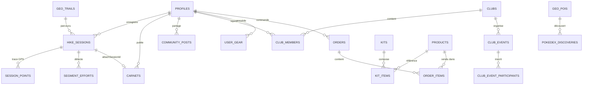

# 02 — Base de Données Supabase (PostgreSQL 17 + PostGIS)

## 1. Informations d'Infrastructure

- **Projet Supabase** : `lekitduvoyageur2` (`icxyvwzfjbflcbqukpfz`)
- **Région** : `eu-west-3` (Paris)
- **Moteur** : PostgreSQL `17.6` + extension **PostGIS**
- **Volumétrie post-nettoyage** : **301 Mo** en base, **380 tables** dans le schéma `public`, **8 buckets Storage** actifs (~335 Mo).

---

## 2. Modèle de Données par Domaine (ERD Synthétique)

### Domaines fonctionnels principaux
1. **Identité & Préférences** : `profiles`, `user_preferences`, `user_documents`, `user_addresses`, `notifications`.
2. **Explorer, GIS & Télémétrie** : `hike_sessions`, `geo_pois`, `geo_pois_coverage`, `geo_trails`, `geo_trails_coverage`, `admin_regions_geo`, `segments`, `segment_efforts`, `live_tracking_sessions`, `pokedex_*`.
3. **Communauté & Carnets** : `community_posts`, `carnets`, `stories`, `highlights`, `pending_contributions`.
4. **Clubs, Sorties & Messagerie** : `clubs`, `club_members`, `club_events`, `club_event_participants`, `club_role_capability_defaults`, `group_role_capability_defaults`, `messages`, `conversations`.
5. **Matériel, Kits & Boutique** : `products`, `kits`, `kit_items`, `user_gear`, `inventory_status_history`, `orders`, `order_items`, `loyalty_history`, `loyalty_rewards`, `loyalty_redemptions`.
6. **Progression, IA & Ops** : `progression_mission_model_actions`, `ai_response_cache`, `api_credit_days`, `feature_flag_cohorts`, `ops_daily_reports`, `hub_telemetry`, `app_errors`.

---

## 3. Sécurité & Politiques RLS (Row Level Security)

- **Toutes les tables applicatives** du schéma `public` ont **RLS activé** (seule exception système : `spatial_ref_sys`, table système PostGIS).
- **Double accès** :
  - Client / SSR utilisateur : clé `NEXT_PUBLIC_SUPABASE_ANON_KEY` soumise aux politiques RLS (`auth.uid()`).
  - Routes serveur privilégiées / Cron / Webhooks : `SUPABASE_SERVICE_ROLE_KEY` (strictement côté serveur via `server-only`).
- **Tables à 0 politique RLS** : Accès réservé exclusivement au rôle `service_role` (tables d'audit, caches IA, quotas API, télémétrie interne).

---

## 4. Supabase Storage (8 Buckets Actifs)

| Bucket | Visibilité | Usage |
| :--- | :---: | :--- |
| `bag-models` | Public | Modèles 3D GLB de sacs/kits *(point d'attention : 6 fichiers = 208 Mo, candidat à compression Draco+WebP)* |
| `outing-media` | Privé | Photos et médias attachés aux sorties GPS |
| `product-images` | Public | Visuels produits boutique & matériel |
| `carnet-media` | Public | Médias des carnets de voyage |
| `message-attachments` | Privé | Pièces jointes de la messagerie |
| `stories-private` | Privé | Stories communautaires |
| `gear-photos` | Public | Photos matériel utilisateur |
| `user-documents` | Privé | Documents personnels (accès signé avec `DOC_SIGNING_SECRET`) |

*(Les 2 buckets vides `group-media` et `carnet-moments-media` ont été supprimés lors du nettoyage.)*

---

## 5. Edge Functions Déployées

| Fonction | JWT | Rôle |
| :--- | :---: | :--- |
| `fetch-osm-trails` | Non | Ingestion et synchronisation de sentiers OpenStreetMap |
| `geo-import` | Oui | Import sécurisé de référentiels géographiques PostGIS |

---

## 6. Migrations & Maintenance

- **Dossier unique** : `supabase/migrations/` (les anciens dossiers `audit/`, `backfill/`, `baseline/`, `migrations_deferred/`, `migrations_frozen/`, `proposals/`, `reconciliation/`, `replay/` ont été supprimés).
- **Règles strictes pour toute nouvelle migration** :
  1. Nommage horodaté `YYYYMMDDHHMMSS_description_snake_case.sql`.
  2. Ne **jamais** utiliser `DROP TABLE ... CASCADE` ; toujours vérifier les dépendances dans `pg_proc`, `pg_views`, `src/` et `scripts/`, puis utiliser `RESTRICT`.
  3. Pour toute nouvelle table : activer RLS et définir immédiatement ses politiques `SELECT` / `INSERT` / `UPDATE` / `DELETE`.
- **Dernier nettoyage effectué** (`20261128150500_drop_38_orphan_empty_tables.sql`) :
  - **31 tables vides 100 % orphelines** supprimées en mode `RESTRICT`.
  - `VACUUM FULL` sur `admin_regions_geo` et `countries_content` (gain immédiat de 20 Mo).
  - **Candidats à revue ultérieure (non supprimés par sécurité)** : 5 tables sans appelant `src/` mais contenant des données (`activity_catalog_metrics`, `user_documents`, `user_addresses`, `segment_condition_buckets`, `club_reports`) et 52 tables appelées par des RPC/triggers SQL.
