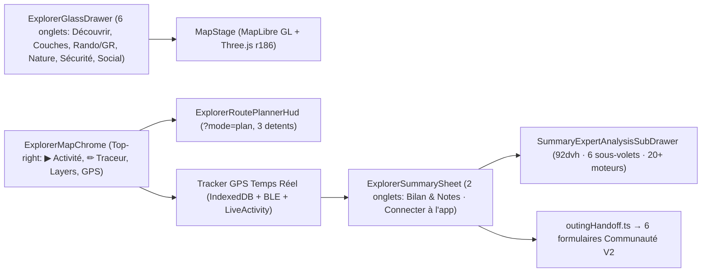

# 04 — Explorer v2, Cartographie 3D & Studio d'Analyse Avancée

## 1. Architecture Explorer v2 (`src/features/explorer-v2/`)

**Explorer v2** (`/explorer`) est le cœur cartographique et sportif de LKDV. Il combine une carte 3D WebGL à 60 FPS, un HUD Apple Liquid Glass à 6 onglets, un traceur d'itinéraire intégré, un tracker GPS temps réel offline-first et un studio d'analyse post-sortie de niveau laboratoire.

---

## 2. Moteur Cartographique 3D & Open-Data (0 €)

- **Rendu** : **MapLibre GL** + couche custom **Three.js `r186`** rendant des dioramas 3D GLB (Draco + WebP) pour les POIs, villages, faune/flore (Pokédex) et repères sociaux.
- **Relief 3D** : Tuiles d'élévation **AWS Terrarium DEM** décodées en pur JS (compatible Cloudflare Workers).
- **6e Onglet « Rando, GR & Activités »** :
  - API `src/app/api/explorer/v2/outdoor-routes/route.ts` connectée à **Waymarked Trails / OpenStreetMap** (`hiking`, `cycling`, `mtb`, `slopes`, `0 €`).
  - Hydratation en direct des polylignes GeoJSON sur la carte 3D + composant `ActivitiesCategoryLenses.tsx`.
- **Traceur d'Itinéraire intégré (`/explorer?mode=plan`)** :
  - Accessible depuis le bouton Crayon en haut à droite (`ExplorerMapChrome.tsx`).
  - HUD 3 detents (`ExplorerRoutePlannerHud.tsx`), clic-carte pour poser des marqueurs numérotés, calcul de profil et sauvegarde directe.

---

## 3. Fin de Sortie (`ExplorerSummarySheet.tsx`) & Handoff Universel

À l'arrêt de n'importe quelle activité, la feuille post-sortie Apple Liquid Glass présente **2 onglets** :
1. **Bilan & Notes** : Header épinglé (`+XP` + statut synchro), grille 2×2 des métriques clés, échelle RPE 1–10 colorée, barre 4 outils (`Analyse`, `Crop`, `GPX`, `Partager`), titre et notes de terrain.
2. **Connecter à l'app** : 11 passerelles interconnectées vers tout LKDV (Carnet, Communauté, Clubs & Sorties, Voyages, Sauver en itinéraire, Bouteille à la mer, Mon sac & Matériel, Progression & XP, Pokédex Nature, Signaler le terrain, Historique).

### Handoff Universel (`src/features/explorer-v2/outingHandoff.ts`)
Sérialise automatiquement toutes les données de la sortie (distance, D+, durée, tracé GPX, sport, localisation, météo, notes, RPE) et pré-remplit les **6 formulaires Communauté V2** (`CarnetFormV2`, `PostFormV2`, `StoryFormV2`, `SortieFormV2`, `KitFormV2`, `ClubFormV2`).

---

## 4. Studio « Analyse Avancée » (6 Sous-Volets · 20+ Moteurs)

Accessible depuis le bouton `Analyse` du résumé de sortie (`SummaryExpertAnalysisSubDrawer.tsx`, hauteur `92dvh`, portée CSS `.xp20-exp-scope`).

### Pipeline de Données
- **Orchestrateur pur TS** : `src/features/explorer-v2/redesign/summary/summaryAnalysisEngine.ts`
- **Hook d'hydratation** : `src/features/explorer-v2/redesign/summary/useSummaryExpertAnalysis.ts`
  - Hydrate les points GPS complets depuis **IndexedDB** (`readSessionPoints`).
  - Charge l'historique offline à 2 niveaux (`readProgressionSessionsSnapshot` + `readAllFinishedSessions`) pour les calculs de charge chronique.
  - Backfill altimétrique 1-tap via **AWS Terrarium DEM** si la trace manque d'altitude.
  - Persiste les seuils physiologiques utilisateur (`fcMax`, `fcRest`, `ftpW`, `vmaKmh`).
  - Détection opt-in de segments via `POST /api/segments/detect`.

### Les 6 Sous-Volets (`src/features/explorer-v2/redesign/summary/panels/`)

| # | Sous-volet | Composant | Moteurs & Calculs connectés |
| :-: | :--- | :--- | :--- |
| **1** | **Synthèse & Bio** | `OverviewBioPanel.tsx` | Score d'effort LCDA + 6 piliers Shapley (`computeEffortScore`), difficulté IBP / km-Effort (`sortiePerformanceEngine`), highlights automatiques (`detectOutingHighlights`), sorties comparables (`findComparableOutings`), export GPX 1.1 / FIT JSON |
| **2** | **Courbes & Télémétrie** | `CurvesTelemetryPanel.tsx` + `InlineInteractiveTraceSvg.tsx` | Courbes synchronisées altitude / allure / pente / FC / puissance, curseur interactif lié à la carte MapLibre, courbe de puissance MMP / FTP (`cycling-physics-v1`) |
| **3** | **Relief & Ascensions** | `ReliefClimbsPanel.tsx` | Détection automatique des montées Cat 1–5 (`analyzeClimbs`), VAM, pentes moyennes/max, profil énergétique Minetti 2002 (`computeSlopeAdjustedPace`), modules spécifiques Ski / Natation / Force |
| **4** | **Allures & Splits** | `PacingSplitsPanel.tsx` | Splits km / mi, allure ajustée pente (GAP), dérive cardiaque & découplage aérobie, meilleurs efforts course (`extractCleanRunningBestEffortsFromTrace`), prédictions Riegel (`computeRacePredictions`) |
| **5** | **Physio & Charge** | `PhysioLoadPanel.tsx` | Charge sRPE (`computeSessionLoadUnits`), modèle Banister CTL / ATL / TSB Avant→Après (`computeTrainingLoad`), Readiness EWMA ACWR / dette métabolique 96h / DOMS excentriques 18–48h / acclimatation altitude 21j (`computeExplorerReadiness`), éditeur inline des seuils physio |
| **6** | **Environnement & Récup** | `EnvironmentRecoveryPanel.tsx` | Éphémérides NOAA offline (`computeOfflineDaylight`), stress thermique (`computeThermalStress`), hydratation estimée (`estimateHydrationLiters`), protocole de récupération 0–48h (`buildRecoveryProgram`), bilan CO₂, synthèse IA opt-in RGPD Art. 9 (`buildAiActivityInsightPayload`) |
