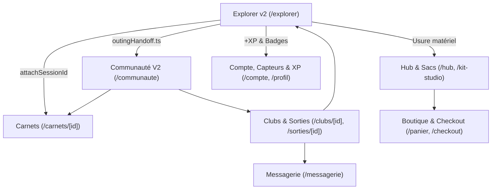

# 05 — Modules Produit & Parcours Utilisateur

Ce guide présente les modules fonctionnels de **Le Kit du Voyageur (LKDV)**, leur rôle produit et leur architecture d'interconnexion.

---

## 1. Communauté V2 (`/communaute`) & Handoff Universel

- **Hub social unifié** : Remplace l'ancien hub `/carnets` (redirigé `308` → `/communaute`). Regroupe le fil communautaire, les reels (`/communaute/reels`), les stories, les publications (`/communaute/post/[id]`) et le tiroir de création `CreateSheetV2.tsx`.
- **6 formulaires pré-remplis automatiquement** depuis une sortie Explorer via `src/features/explorer-v2/outingHandoff.ts` :
  1. `CarnetFormV2` — Carnet de voyage avec récit, trace GPX, D+, distance, durée et localisation.
  2. `PostFormV2` — Post communautaire illustré avec stats de la sortie.
  3. `StoryFormV2` — Story terrain géolocalisée.
  4. `SortieFormV2` — Proposition de sortie collective basée sur le tracé réalisé.
  5. `KitFormV2` — Partage du kit/matériel utilisé sur la sortie.
  6. `ClubFormV2` — Partage et création dans un espace Club.

---

## 2. Carnets de Voyage (`/carnets/[id]`)

- Chaque carnet publié possède sa propre page riche (récit multi-étapes, carte interactive 3D `CarnetMap`, photos, matériel embarqué et lien vers la sortie GPS d'origine).
- Les anciens liens `/carnets` (hub) sont automatiquement redirigés en `308` vers `/communaute`.

---

## 3. Clubs & Sorties Collectives (`/clubs/[id]`, `/sorties/[id]`)

- **Espaces Clubs** : Gestion hiérarchique des rôles (`club_role_capability_defaults`), carte 3D alpine synchronisée avec le fil du club (`ClubMap`), événements et inscriptions (`club_event_participants`).
- **Sorties collectives** (`/sorties/[id]`) : Propositions d'itinéraires (`ClubEventRouteProposal`), liste de matériel partagé, covoiturage/organisation et suivi participants.

---

## 4. Hub Voyageur, Matériel & Kit Studio (`/hub`, `/kit-studio`)

- **Hub Voyageur** (`/hub`, `/hub/[section]`, `/hub/nouveau`) : Préparation d'expéditions, checklists, gestion de l'inventaire personnel (`user_gear`), suivi d'usure kilométrique.
- **Kit Studio** (`/kit-studio`) : Studio visuel 3D de composition de sac (poids total, répartition, simulation d'encombrement et export de kit).

---

## 5. E-Commerce & Fidélité (`/panier`, `/checkout`)

- **Tunnel d'achat** : Panier persistant, paiement sécurisé **Stripe** (`/api/stripe`, `/api/checkout`, `/api/orders`).
- **Programme fidélité** : Historique de points (`loyalty_history`), récompenses (`loyalty_rewards`) et échanges (`loyalty_redemptions`).

---

## 6. Compte, Capteurs, Live Tracking & Progression (`/compte`, `/profil`, `/live/[token]`)

- **Compte (`/compte/*`)** :
  - `/compte/activites` — Historique complet des sorties avec filtres.
  - `/compte/connecteurs` & `/compte/montres` — Synchronisation montres GPS et plateformes tierces.
  - `/compte/sensors` — Appairage capteurs BLE (cardio, cadence, puissance).
  - `/compte/suivi-en-direct` — Partage de position temps réel vers `/live/[token]` (sécurité terrain).
- **Progression & XP** : Économie de points 2.0 (`docs/progression/2.0/economie.md` & `rules-registry.json`), missions, badges, niveaux et Pokédex Nature (découvertes faune/flore géolocalisées).

---

## 7. Messagerie (`/messagerie`)

- Conversations privées et discussions de groupe/club avec pièces jointes stockées dans le bucket privé `message-attachments` et notifications push Capacitor.
