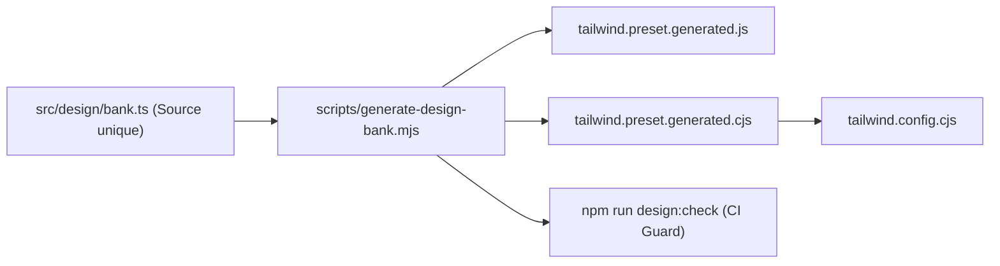

# 06 — Design System & Apple Liquid Glass

## 1. Architecture Design Bank (`src/design/bank.ts`)

Le Design System de LKDV repose sur une **source de vérité unique** (`src/design/bank.ts`) compilée automatiquement par `scripts/generate-design-bank.mjs` avant chaque `dev` et `build`.

- **Règle absolue** : Ne jamais modifier manuellement `tailwind.preset.generated.js` ou `.cjs`. Modifier `src/design/bank.ts`, regénérer, puis valider avec `npm run design:check`.

---

## 2. Identité Visuelle : Apple Liquid Glass

- **Mode par défaut** : **Mode Clair Liquid Glass** (`#FBFAF6` fond parchemin/ivoire, vert forêt primaire `#17402C`, surfaces translucides floutées `backdrop-filter: blur(...)`, bordures hairline et ombres douces).
- **Feuilles de styles clés** :
  - `src/styles/tokens.css` — Variables CSS sémantiques (couleurs, rayons, élévations, typographie).
  - `src/styles/liquid-glass.css` — Composants verre dépoli globaux (cards, pills, barres, modales).
  - `src/styles/explorer-glass.css` — Système de feuilles/drawers Explorer v2, thèmes terrain et mode gants.
  - `src/styles/tailwind.css` — Directives Tailwind et utilitaires.

---

## 3. Thèmes & Modes Terrain

| Thème | Usage | Spécificités |
| :--- | :--- | :--- |
| **`light` (défaut)** | Jour / plein soleil | Fond `#FBFAF6`, contraste élevé, surfaces Liquid Glass claires |
| **`dark`** | Soir / confort visuel | Surfaces sombres translucides, encres claires |
| **`night-red`** | Bivouac / vision nocturne | Filtre rouge préservant l'adaptation scotopique, contrastes dédiés sur les barres & graphiques |
| **`glovesMode`** | Hiver / montagne | Cibles tactiles élargies à **60 px minimum** dans le HUD Explorer |

---

## 4. Règle Critique — Portaled Sub-Drawers (`ExplorerNestedSubDrawer`)

> [!CAUTION]
> Ne **JAMAIS** appliquer `.xp20-root` à l'intérieur d'un sub-drawer portaled (`ExplorerNestedSubDrawer`).
> `.xp20-root` impose `position: fixed; inset: 0; overflow: hidden;` ce qui effondre la hauteur du portail à `131 px` et masque les onglets.
> Toujours utiliser **`.xp20-exp-scope`** pour isoler les variables et styles d'un sub-drawer portaled (`92dvh`), avec réinitialisation de `scrollTop = 0` sur `.xp20-nested-body` lors des changements d'onglets.

---

## 5. Accessibilité & Responsive Mobile

- **Mobile-first** : Conçu et audité en priorité sur viewport mobile (`390×844` / `402×874`) avec safe-areas iOS/Android (`env(safe-area-inset-*)`).
- **WAI-ARIA** : Onglets (`role="tablist"`, `role="tab"`, `role="tabpanel"`), modales/drawers (`role="dialog"`, gestion focus), contraste WCAG AA vérifié via `@axe-core/playwright`.
- **Mouvement réduit** : Respect de `prefers-reduced-motion` sur les transitions Framer Motion.
