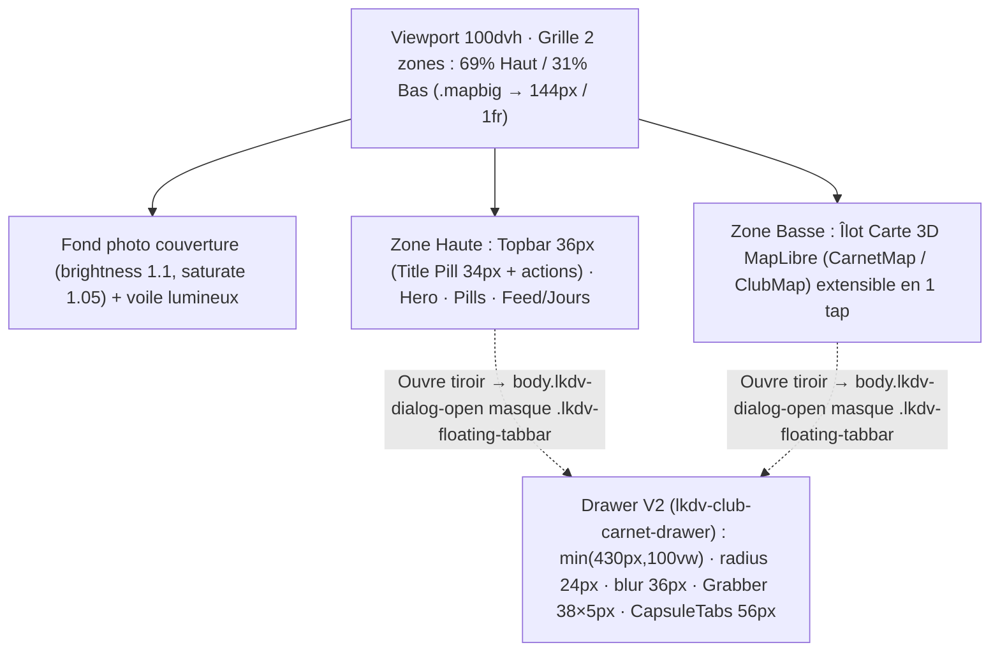

# 06 — Bible Design System LKDV (Vérité Unique : `Carnets` & `Clubs`)

> **Règle Absolue** : Ce document est la **seule référence design officielle** de Le Kit du Voyageur (LKDV).
> Il est extrait directement des **deux seules pages de vérité visuelle** du produit :
> 1. **`/carnets/[id]`** → `src/components/carnet/v2/CarnetScreenV2.tsx` + `src/styles/carnet-v2.css`
> 2. **`/clubs/[id]`** → `src/components/clubs/ClubLiquidGlassV8.tsx` + `src/components/clubs/drawer/club-drawers-v2.css`
> 3. **Socle de jetons** → `src/design/bank.ts` (compilé par `scripts/generate-design-bank.mjs`)
>
> Toute nouvelle page, composant, drawer ou refonte **doit** s'aligner sur cette grammaire. Si un ancien écran diverge, c'est l'ancien écran qui a tort.

---

## 1. Identité Fondamentale : 100 % Mode Clair Liquid Glass — Pure Palette Verte LKDV

- **Lumière & Nature** : toile ivoire/parchemin lumineuse (`#FBFAF6` / `#F5F2EC`), verres blancs dépolis translucides, encres vert forêt profondes.
- **ZÉRO NOIR PUR (Interdit absolu)** : `#000000`, `#101010`, `#121815` et tout gris neutre froid sont **strictement bannis** (encres, bordures, ombres et fonds sont toujours teintés vert forêt `#172B24` / `#17402C`).

---

## 2. Palette Officielle (`src/design/bank.ts` + `carnet-v2.css` + `club-drawers-v2.css`)

### Surfaces & Fonds
| Token | Valeur exacte | Usage |
| :--- | :--- | :--- |
| `surfaces.canvas` (`--bg-body`) | `#FBFAF6` | Fond principal papier/ivoire de toute l'app |
| `carnet --page` | `#F5F2EC` | Toile chaude des vues Carnet plein écran |
| `surfaces.sauge` | `#F5F7F3` | Fond sauge très pâle / fallback |
| `surfaces.surfaceElevated` | `#FFFFFF` | Cartes et surfaces verre blanc pur |
| `surfaces.surfaceGrouped` | `#F0F5EE` | Groupes type iOS `InsetGroupedList` |
| `surfaces.surfaceMuted` | `#EDF1EA` | Surfaces secondaires / pills neutres |
| `carnet --mint` | `#EBF2EC` | Teinte menthe douce (verre prominent) |
| `surfaces.border` / `--sep` | `rgba(23, 43, 36, 0.12)` / `0.10` | Séparateurs & bordures hairline teintées forêt |
| `surfaces.borderSubtle` | `rgba(23, 43, 36, 0.06)` | Séparateurs discrets |
| `surfaces.borderStrong` | `rgba(23, 43, 36, 0.24)` | Bordures actives / focus |

### Encres (Contraste WCAG AAA / AA)
| Token | Valeur exacte | Usage |
| :--- | :--- | :--- |
| `inks.labelPrimary` (`--label`) | `#172B24` | Texte principal (WCAG AAA sur `#FBFAF6` & `#FFFFFF`) |
| `inks.labelSecondary` (`--label2`) | `#56665D` | Sous-titres, métadonnées (WCAG AA) |
| `inks.labelTertiary` (`--label3`) | `#46584D` / `rgba(23, 43, 36, 0.44)` | Labels secondaires, placeholders |
| `inks.labelQuaternary` | `#8C9790` | Indices subtils, icônes inactives |
| `inks.onBrand` / `onAction` / `onMedia` | `#FFFFFF` | Texte sur boutons verts ou sur photo |
| `inks.scrim` | `rgba(16, 28, 23, 0.42)` | Voile protecteur lisible sur média plein écran |

### Marque, Actions & Statuts
| Token | Valeur exacte | Usage |
| :--- | :--- | :--- |
| `brand.primary` (`--tint`) | `#17402C` | Vert forêt signature (titres, pills actives, boutons pleins) |
| `brand.primaryHover` | `#205238` | Survol primaire |
| `brand.action` | `#226148` | CTA principal / action positive |
| `brand.actionHover` | `#1B4F3A` | Survol CTA |
| `brand.secondary` (`--accent`) | `#5B7F55` | Vert sauge secondaire |
| `brand.primarySubtle` (`--club-soft-bg`) | `#D3EBD9` | Badges doux, fonds de sélection |
| `status.success` (`--good`) | `fg #3D6038` · `bg #EAF3E9` · `border #B4D4B0` | Validation, synchro OK |
| `status.warning` (`--warn`) | `fg #8F671E` · `bg #FBF1DC` · `border #E8CF96` | Avertissement, prudence terrain |
| `status.danger` (`--bad`) | `fg #85261E` · `bg #F5DDD9` · `border #DFA8A1` | Alerte, danger, suppression |
| `status.info` (`--info` / `--water`) | `fg #2C4C5E` · `bg #DDE7EE` · `border #A3BDCC` (`#3F93B8` eau) | Information, hydrologie |

---

## 3. Système Liquid Glass (4 Niveaux Officiels)

| Niveau | Alias | Fond (`bg`) | Flou (`blur`) | Saturation | Usage type (`Carnets` & `Clubs`) |
| :---: | :---: | :--- | :---: | :---: | :--- |
| **`g1`** | `clear` | `rgba(255, 255, 255, 0.65)` | `12px` | `180%` | Badges flottants légers, overlays discrets |
| **`g2`** | `regular` | `rgba(255, 255, 255, 0.85)` | `24px` | `180%` | Cartes standard, popovers, panneaux de contenu |
| **`g3`** | `prominent` | `rgba(235, 242, 236, 0.88)` | `36px` | `190%` | Drawers V2, barres dominantes (`reducedBg: #EBF2EC`) |
| **`gc`** | `capsule` | `rgba(255, 255, 255, 0.72)` | `20px` | `180%` | Pills de navigation, `lkdv-title-pill`, `CapsuleTabs` |

### Finition Spéculaire & Ombres Teintées Forêt
- **Rim externe** : `0 0 0 0.5px rgba(23, 43, 36, 0.14)`
- **Rim interne** : `inset 0 0 0 0.5px rgba(255, 255, 255, 0.65)`
- **Reflet haut (specular)** : `inset 0 1px 0 rgba(255, 255, 255, 0.75)`
- **Ombre standard** : `0 10px 32px rgba(23, 64, 44, 0.12)`
- **Ombre élevée (drawers/modales)** : `0 16px 48px rgba(23, 64, 44, 0.16)`

---

## 4. Anatomie des 2 Écrans de Référence (`Carnets` & `Clubs`)

### Règles de Structure Incontournables
1. **Topbar compacte (`36px`)** : `lkdv-title-pill` (`height: 34px`, `border-radius: 9999px`, `blur(16px)`, `color: #17402C`, `max-width: 210px`) + boutons circulaires verre à droite.
2. **Drawers V2 (`club-drawers-v2.css` / `carnet-v2.css`)** :
   - Largeur `min(430px, 100vw)`, `border-radius: 24px`, fond dégradé `linear-gradient(180deg, rgba(255,255,255,0.98) 0%, rgba(251,250,246,0.96) 100%)`, `backdrop-filter: blur(36px) saturate(1.1)`.
   - Poignée grabber `38×5px` (`rgba(23,43,36,0.22)`), sélecteur `CapsuleTabs` hauteur **`56px`**.
   - À l'ouverture d'un drawer (`body.lkdv-dialog-open`), la barre flottante `.lkdv-floating-tabbar` s'efface (`opacity: 0; transform: translateY(120%)`).
3. **Mode `outdoor` (plein soleil)** : augmente l'opacité du verre (`--ga: 0.9; --gb: 30px`), renforce `--label2: #2F3F37` et passe la taille de base à `15px`.
4. **Réduction de mouvement scopée** : `[data-reduce-motion='true']` scopé à la racine de l'écran (jamais `*` global).

---

## 5. Typographie, Rayons, Espacements & Motion (`src/design/bank.ts`)

### Dynamic Type Apple
- **Polices** : `sans` (`SF Pro Text` / `Inter`), `display` (`SF Pro Display`), `brand` (`Manrope`), `serif` (`Instrument Serif`), `mono` (`IBM Plex Mono`).
- **Échelle** : `largeTitle` `34/41 (700)` · `title1` `28/34 (700)` · `title2` `22/28 (700)` · `title3` `20/25 (600)` · `headline` `17/22 (600)` · `body` `17/22 (400)` · `callout` `16/21` · `subheadline` `15/20` · `footnote` `13/18` · `caption1` `12/16` · `caption2` `11/13`.

### Rayons Concentriques & Z-Index
- **Rayons** : `xs: 12px` · `sm: 16px` · `md: 20px` · `lg: 24px` · `card: 28px` · `hero: 38px` · `sheet: 44px` · `pill: 9999px` (règle concentrique : `rayon_interne = rayon_externe - padding`, plancher `20px`).
- **Cibles tactiles** : minimum **`44px`** (iOS) / **`48dp`** (Android) · `navHeight: 60px` · `tabBarHeight: 64px` · `bottomClearance: 88px`.
- **Z-Index** : `base: 1` · `sticky: 100` · `subbar: 200` · `tabbar: 300` · `hud: 400` · `sheet: 500` · `modal: 600` · `alert: 700`.
- **Motion** : `instant: 100ms` · `fast: 200ms` · `med: 300ms` · `slow: 450ms` · `pressScale: 0.97` (courbes tokenisées uniquement : `--ease-spring`, `--ease-smooth`, `--ease-glass`, `--ease-emphasis`).

---

## 6. Liste des Interdits & Workflow Design Bank

1. **Jamais** de noir pur (`#000`, `#101010`, `#121815`) ni de fond sombre par défaut (hors mode spécial terrain `night-red` d'Explorer).
2. **Jamais** de `.xp20-root` dans un sub-drawer portaled (`ExplorerNestedSubDrawer`) → utiliser `.xp20-exp-scope`.
3. **Jamais** éditer `tailwind.preset.generated.js` / `.cjs` à la main → modifier `src/design/bank.ts` puis lancer `npm run design:check`.
4. **Jamais** de valeurs magiques non tokenisées pour les courbes de transition ou les z-index.
