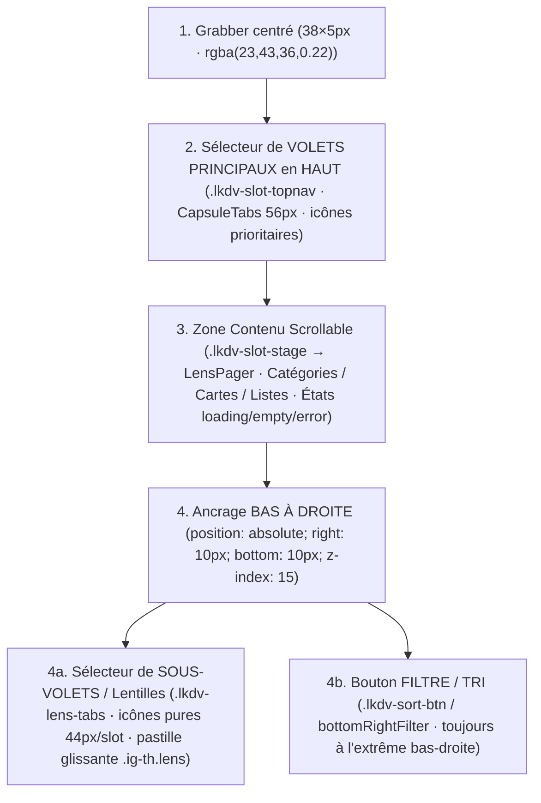

# Le Pilier Drawers & Navigation Interne — LKDV

> Les drawers sont la colonne vertébrale de toute l'application LKDV (`Carnets`, `Clubs`, `Communauté`, `Compte`, `Explorer`, `Kit Studio`, `Hub`).
> **Règle d'or** : Tous les drawers partagent la **même grammaire interne**, mais **le contenu s'adapte toujours au mode d'ouverture du drawer — jamais l'inverse**.

---

## 1. Anatomie Universelle d'un Drawer LKDV (`SlotShell`)

Référence code : `src/components/compte/drawer/SlotShell.tsx` + `src/components/clubs/drawer/club-drawers-v2.css` + `src/styles/communaute-v2-shell.css`.

### Détails Contractuels de Chaque Zone
1. **Enveloppe du Drawer V2** :
   - Fond : `linear-gradient(180deg, rgba(255,255,255,0.98) 0%, rgba(251,250,246,0.96) 100%)`
   - Verre : `backdrop-filter: blur(36px) saturate(1.1)`
   - Bordure/Ombre : `inset 0 1px 0 rgba(255,255,255,0.98)`, `inset 0 0 0 0.5px rgba(27,67,50,0.12)`, `0 18px 48px rgba(16,32,25,0.16)`
   - Effacement de la barre basse : dès qu'un drawer s'ouvre, `body.lkdv-dialog-open` masque `.lkdv-floating-tabbar` (`opacity: 0; pointer-events: none; transform: translateY(120%)`).
2. **Sélecteur de Volets Principaux (HAUT)** :
   - Conteneur `.lkdv-slot-topnav` → `.lkdv-slot-selector.lkdv-capsule` de hauteur fixe **`56px`** (`padding: 4px`, verre `gc`).
   - Pastille active glissante `.ig-th` (animation spring).
   - **Icônes en priorité** ; si un libellé est présent, 1 mot court max.
3. **Zone de Contenu (CENTRE — `LensPager`)** :
   - Swipe horizontal fluide entre sous-volets (`LensPager`), chaque pane isolée par `aria-hidden` + `inert` quand inactive.
   - Toujours gérer les **3 états standards** : `loading` (`SkeletonState`), `empty` (`EmptyState` concis), `error` (`ErrorState` + bouton `Réessayer`).
   - Prévoir un `padding-bottom` suffisant (`≥ 68px`) pour que le dernier élément ne soit jamais masqué par les contrôles flottants du bas à droite.
4. **Sélecteur de Sous-Volets + Filtres (BAS À DROITE — Immuable)** :
   - **Sous-volets (lentilles)** : `.ig-tabs.lkdv-lens-tabs` en **icônes pures** (`44px` par onglet, `aria-label` + `title`, navigation clavier flèches / Home / End).
   - **Filtre / Tri (`bottomRightFilter` / `SortMenuButton`)** : **toujours ancré en bas à droite** (`right: 10px; bottom: 10px; z-index: 15`). Quand présent, `.lkdv-lens-tabs.has-sort` se décale proprement à sa gauche sans jamais chevaucher.

---

## 2. Les 4 Modes d'Ouverture & Règle d'Adaptation du Contenu

Toutes les pages n'ont pas la même forme, et tous les drawers ne s'ouvrent pas de la même manière. **C'est le contenu interne qui s'adapte au conteneur du drawer, jamais l'inverse** :

| Mode d'ouverture | Exemples dans l'app | Contraintes conteneur | Comment le contenu doit s'adapter |
| :--- | :--- | :--- | :--- |
| **1. Bottom Sheet multi-detents** | Explorer v2 (`ExplorerGlassDrawer`, `ExplorerRoutePlannerHud`), Carte | Hauteur dynamique (`peek` / `half` / `full`) sur carte 3D active | Contenu en flux vertical fluide (`min-height: 0; overflow-y: auto`), KPIs essentiels visibles dès le detent bas, contrôles bas-droite toujours accessibles |
| **2. Drawer Carte Clippée V2** | `Carnets` (`CarnetDrawerV2`), `Clubs` (`ClubDrawerHost`), `Communauté V2`, `Compte` | `width: min(430px, 100vw)`, `border-radius: 24px`, plein cadre hauteur | `SlotShell` complet : `CapsuleTabs` 56px en haut + `LensPager` au centre + lentilles & filtre en bas à droite |
| **3. Sub-Drawer Portaled Imbriqué** | `ExplorerNestedSubDrawer` (Analyse Avancée 6 volets, Crop, Partage) | Portail `92dvh`, **portée `.xp20-exp-scope` obligatoire** (jamais `.xp20-root`) | Header compact épinglé + barre d'onglets sticky + corps scrollable `.xp20-nested-body` avec **reset `scrollTop = 0`** au changement d'onglet |
| **4. Sheet de Création / Action** | `CreateSheetV2` (6 formulaires), `ExplorerSummarySheet`, `StoryViewsSheet` | Header épinglé + corps formulaire + **footer sticky verre dépoli** | Champs `lkdv-cv2-field` compacts, étapes `StepPager`, CTA primaire toujours accessible en bas sans scroll infini |

---

## 3. Modes Terrain & Accessibilité dans les Drawers

- **Mode `outdoor` (plein soleil)** : opacité verre renforcée (`--ga: 0.9; --gb: 30px`), `--label2: #2F3F37`, corps `15px`.
- **Mode `glovesMode` (montagne/hiver)** : cibles tactiles élargies à **60 px**.
- **Mode `night-red` (bivouac Explorer)** : contraste dédié sur les pistes de barres et boutons actifs sans aucune fuite de blanc pur.
- **Clavier & Lecteurs d'écran** : `role="dialog"`, `role="tablist"`, `role="tab"`, `role="tabpanel"`, roving `tabIndex`, `Escape` pour fermer.
