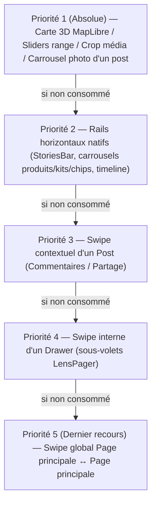

# Gestes Tactiles, Hiérarchie des Swipes, Animations & Dictionnaire d'Icônes — LKDV

> Ce document verrouille **toutes les interactions tactiles, la hiérarchie anti-conflit des swipes, la loi de sobriété (zéro doublon), les micro-interactions et l'unicité des icônes** sur l'ensemble de l'application LKDV.

---

## 1. Grammaire Tactile Universelle

| Contexte | Geste | Comportement attendu |
| :--- | :--- | :--- |
| **Pages principales** | Swipe horizontal `← / →` | Passage fluide de page principale en page principale |
| **Drawer — Sous-volets** | Swipe horizontal `← / →` | Changement de sous-volet / lentille (`LensPager`) synchronisé avec `.lkdv-lens-tabs` en bas à droite |
| **Drawer multi-élévations** | Swipe vertical `↓` (encoche / header) | Descend **d'un cran** (ex. `full → half → peek`, ou ferme depuis le cran le plus bas si fermable) |
| **Drawer multi-élévations** | Swipe vertical `↑` (encoche / header) | Monte **d'un cran** (inverse exact : `peek → half → full`) |
| **Drawer simple (1 état)** | Swipe vertical `↓` (encoche / header) | Ferme le drawer (avec inertie spring) |
| **Post (Flux / Club / Carnet)** | Swipe horizontal contextuel | Ouvre directement l'écran **Commentaires** ou **Partage** sans changer de page |
| **Stories / Carrousels** | Swipe horizontal `← / →` | Fait défiler les Stories, produits, kits ou photos du post sans déclencher de navigation globale |

---

## 2. Hiérarchie Stricte d'Arbitrage des Swipes (Zéro Conflit)

> **Règle d'or** : Le geste est **toujours consommé par la couche la plus profonde sous le doigt**. Une couche parente ne doit **jamais** voler un swipe à un composant enfant interactif.

### Implémentation Technique Obligatoire
- Toute zone de Priorité 1 ou 2 déclare explicitement `data-no-swipe` (ou appartient aux bloqueurs reconnus : `input[type="range"]`, `.maplibregl-canvas`, `[data-no-swipe]`, conteneurs `overflow-x: auto` ayant encore du défilement disponible dans la direction du geste).
- **Verrou directionnel** : dès que le mouvement initial dépasse `10px` sur un axe (horizontal vs vertical), l'axe perpendiculaire est verrouillé jusqu'au `pointerup` pour éviter tout tremblement diagonal.
- **Un drawer ouvert bloque toujours le swipe entre pages principales** (Priorité 5 désactivée tant que `body.lkdv-dialog-open` ou qu'un drawer modal est actif).

---

## 3. Loi de Sobriété : Zéro Fonction en Double

1. **Pas de bouton croix (`×`) redondant sur les drawers** : l'encoche centrale haute (**grabber `38×5px`**) est le contrôle unique de taille/élévation et de fermeture (par swipe vers le bas ou tap sur l'encoche). On ne rajoute **jamais** une croix `×` en plus quand l'encoche remplit déjà ce rôle. *(Exception rare : modale plein écran non-draggable ou alerte système bloquante.)*
2. **Un seul emplacement par fonction** :
   - Changer de catégorie principale → **haut** du drawer (`CapsuleTabs`).
   - Changer de sous-catégorie → **bas à droite** (lentilles icônes).
   - Filtrer / trier → **extrême bas à droite** (`SortMenuButton`).
3. **Zéro texte qui répète une icône évidente** : si l'icône parle d'elle-même (fermer, partager, filtrer, recentrer GPS, lancer activité), pas de libellé visible superflu — uniquement `aria-label` + `title` pour l'accessibilité.

---

## 4. Animations, Micro-Interactions & Effets (Unicité Totale)

Toutes les transitions utilisent **exclusivement** les jetons de `src/design/bank.ts` (aucune durée ni courbe `cubic-bezier` écrite en dur) :

| Interaction | Durée | Courbe | Effet visuel & Haptique (Capacitor) |
| :--- | :---: | :--- | :--- |
| **Appui bouton / pill / carte** | `100ms` (`instant`) | `--ease-emphasis` | `transform: scale(0.97)` (`pressScale`) · `Haptics.impact('light')` |
| **Pastille glissante (`CapsuleTabs` / `LensTabs`)** | `300ms` (`med`) | `--ease-spring` | Glissement spring continu `.ig-th` · `Haptics.selectionChanged()` |
| **Changement de cran / ouverture Drawer** | `300–450ms` (`med`/`slow`) | `--ease-glass` / `--ease-spring` | Interpolation fluide hauteur + opacité scrim · `Haptics.impact('medium')` au franchissement d'un cran |
| **Masquage `.lkdv-floating-tabbar`** | `250–350ms` | `--motion-ease-standard` | `opacity: 0; transform: translateY(120%)` |
| **Transition `.mapbig` (Carte ↔ Contenu)** | `450ms` (`slow`) | `--motion-ease-standard` | Morphing fluide de la grille sans saut de layout |
| **Validation / Succès (Enregistrement, Publié)** | `200ms` (`fast`) | `--ease-spring` | Pill feedback vert `#3D6038` · `Haptics.notification('success')` |

---

## 5. Dictionnaire Canonique d'Icônes (1 Concept = 1 Icône Partout)

Librairie unique : **Lucide React** (`strokeWidth={1.9}` par défaut, `2.2` sur état actif). Ne **jamais** utiliser deux icônes différentes pour la même action selon la page :

| Concept / Action | Icône Lucide unique | Règle d'usage |
| :--- | :--- | :--- |
| **Explorer / Découvrir** | `Compass` | Onglet Explorer & découverte |
| **Carte / Couches** | `Layers` / `Map` | Sélecteur de couches (`Layers`), bascule carte (`Map`) |
| **Recentrer GPS** | `LocateFixed` | Contrôle GPS carte |
| **Lancer activité** | `Play` | CTA principal démarrage tracker (haut droite Explorer) |
| **Traceur d'itinéraire** | `Pencil` / `Route` | Mode édition trace (`Pencil`), aperçu itinéraire (`Route`) |
| **Rando / Montagne / D+** | `Mountain` / `TrendingUp` | Catégorie outdoor (`Mountain`), dénivelé D+ (`TrendingUp`) |
| **Nature / Pokédex** | `Leaf` | Onglet Nature & observations faune/flore |
| **Sécurité / Danger terrain** | `ShieldAlert` | Onglet sécurité & signalements |
| **Clubs / Social / Cordée** | `Users` | Clubs, membres, sorties collectives |
| **Carnet de voyage** | `BookOpen` | Carnets & pilules contextuelles carnet |
| **Sac / Matériel / Kit** | `Backpack` | Inventaire, Kit Studio, sac |
| **Filtrer / Trier** | `SlidersHorizontal` / `ArrowUpDown` | Bouton bas à droite des drawers |
| **Commenter** | `MessageCircle` | Posts, Reels, Carnets, Clubs |
| **Partager** | `Share2` / `Send` | Sheet de partage (`Share2`), envoi message (`Send`) |
| **Aimer / Favori** | `Heart` / `Bookmark` | Like social (`Heart`), enregistrer (`Bookmark`) |
| **Analyse / Télémétrie** | `Activity` | Studio d'analyse avancée & historique sorties |
| **Réglages** | `Settings` | Paramètres compte/club/carnet |
| **Supprimer** | `Trash2` | Action destructive (toujours rouge `--bad` + confirmation) |
