# Storyboard statique — « La Chaîne »

Étape 4 · film vertical de 30 s (1080 × 1920, 30 i/s) · 22 plans, une image par plan à son instant le plus représentatif. Rien n'est animé ni rendu en vidéo.

- Images : `p01.png` … `p22.png` ; planche : `planche.jpg` ; page autonome lisible sur téléphone : `storyboard.html`.
- Sources des compositions : `src/pNN.html` (HTML statique, polices Inter et EB Garamond italique, mêmes règles que HyperFrames), rendues par `node src/render.mjs` (Chromium, WebGL logiciel pour la 3D).
- Légende : **capture réelle** = interface reconstruite à l'identique d'après les captures de production ; **★ maquette — à capturer** = contenu qui n'existe pas encore dans l'app, à créer dans le compte de démo avant le tournage (étape 5).
- Grille : 92,80 BPM, temps 0,6465 s, croche 0,323 s (`audio/temps-forts.json`).

## 01 · Un post

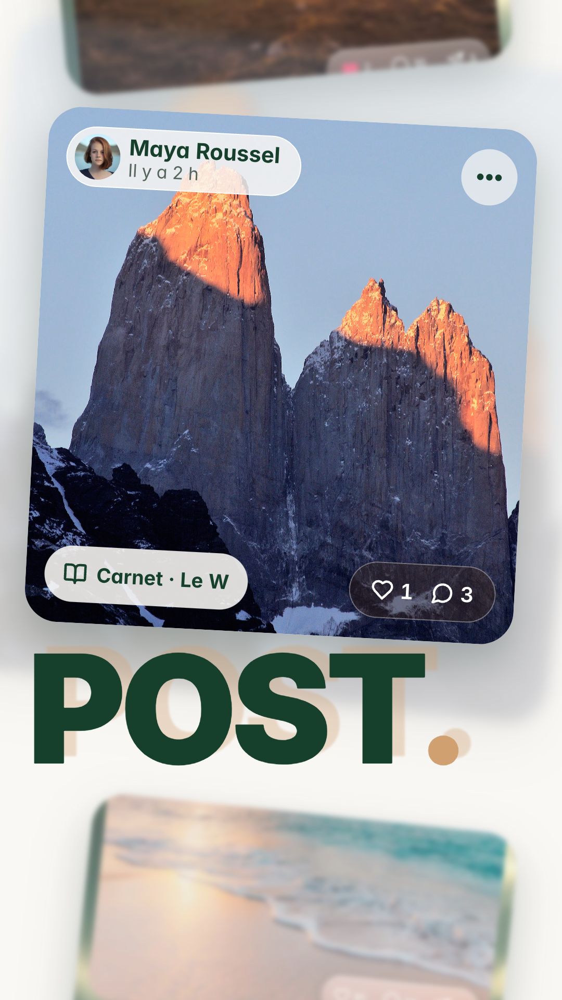

- **Minutage** : 0,000 → 0,647 s · image montrée : 0,32 s (« POST. » vient de claquer)
- **Ce qui bouge** : La photo du post (aube sur les Torres) remplit l'écran à ×2,6 et recule en 5 images (`expo.out`, dépassement 0,97) dans sa carte du fil Communauté, inclinée de 8° qui se redresse (3° sur l'image). Deux autres posts glissent en parallaxe au-dessus et en dessous (×0,6, flou 5 px). Un écho flou de la carte (×1,12, 18 %) garde la trace du recul. « UN » claque à 0,000 puis « POST. » à 0,323 (ressort 1,45 → 0,93 → 1, fantôme laiton 2 images, point laiton).
- **Transition de sortie** : — (coupe sur le temps, le cœur naît dans la même carte)
- **Temps fort musical** : Impact 0,000 (retour du beat, 0,90) ; croche 0,323
- **Sources** : Fil Communauté reconstruit d'après `feed-1.jpg` (même pastille auteur, même pilule ♥ / 💬, posts voisins = vraies captures `feed-1`, `feed-2`). Photo Commons (LBM1948, CC BY-SA 4.0). ★ maquette — à capturer : le post de Maya et sa pastille « Carnet · Le W ».

## 02 · Double-tap

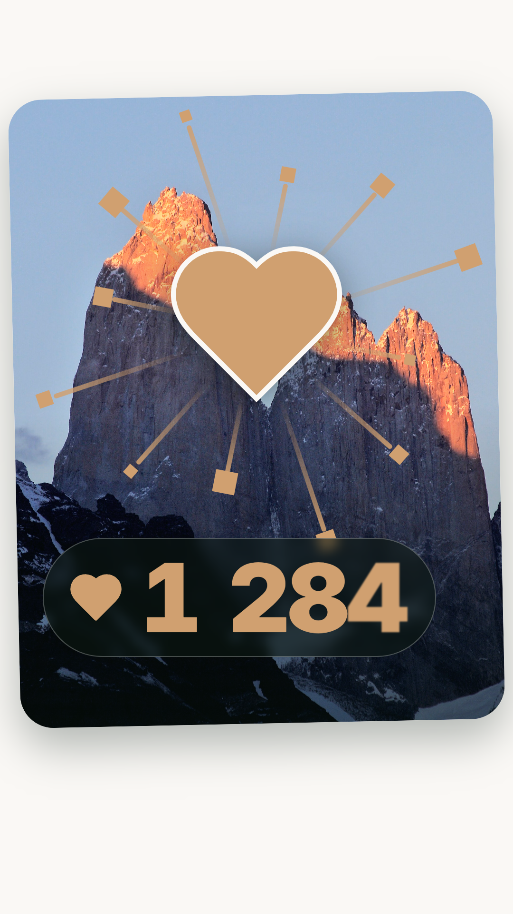

- **Minutage** : 0,647 → 1,282 s · image montrée : 0,75 s (image 3 de l'explosion)
- **Ce qui bouge** : Double-tap : un cœur laiton de 420 px éclate en 12 éclats sur trajectoires radiales (5 images), compteur ♥ qui défile 1 → 1 284 (dernier chiffre en flou de roulement), secousse 4 images (14 → 6 px), caméra qui pousse de 4 %.
- **Transition de sortie** : Match cut : la photo grandit (rayon 32 → 0) et devient le fond du carnet
- **Temps fort musical** : Caisse claire 0,657 (0,82)
- **Sources** : Pilule de compteur de l'app agrandie. ★ maquette — à capturer : le chiffre 1 284 (compte de démo, pas une traction réelle).

## 03 · Le carnet de Maya

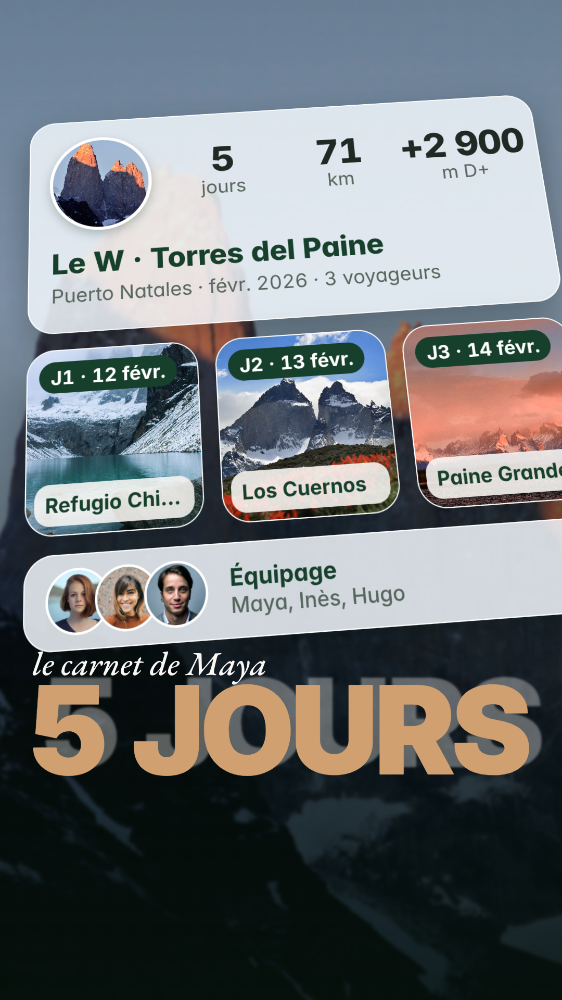

- **Minutage** : 1,282 → 2,586 s · image montrée : 1,95 s (« 5 JOURS » à 1,940)
- **Ce qui bouge** : La photo devient le fond flouté du carnet. Les tuiles réelles du carnet v2 arrivent en bento 3D (rotation X 14°, Z −4°, parallaxe 3 plans), une par croche : en-tête (anneau photo, 5 jours · 71 km · +2 900 m D+), cartes postales J1 · J2 · J3 (puce Forest « J1 · 12 févr. »), Équipage. « 5 JOURS » claque en laiton (236 px), contrepoint Garamond « le carnet de Maya ».
- **Transition de sortie** : Zoom-through dans le tiroir « Sac »
- **Temps fort musical** : Grosse caisse 1,282 (0,96) ; croches ; « 5 JOURS » sur 1,940
- **Sources** : Composants reconstruits d'après `carnet-ouvert.jpg` et `carnet-tmb-jours.jpg` (« Une carte postale par jour », puces de jour, Équipage). Photos Commons (Alvarez, Delso, Szekely). ★ maquette — à capturer : carnet « Le W » de Maya, ses chiffres (71 km, +2 900 m), ses dates et son équipage (Maya, Inès, Hugo).

## 04 · Reprendre le kit

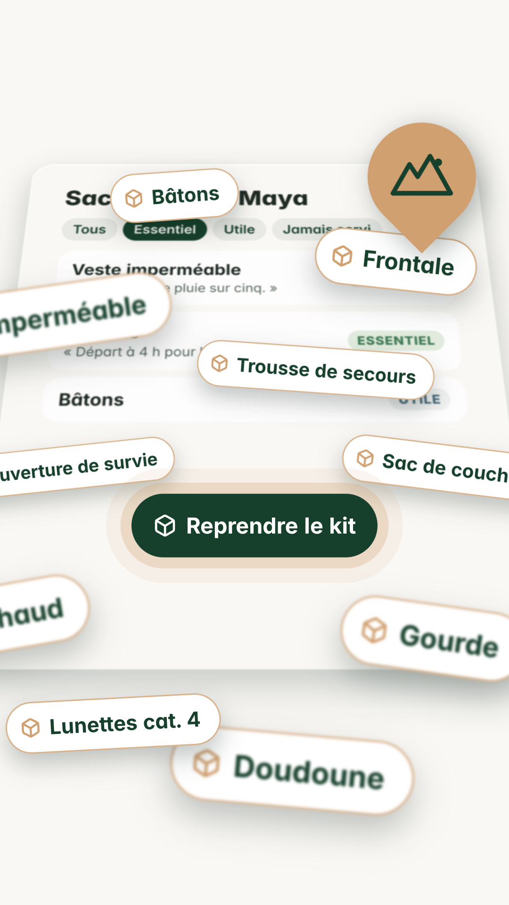

- **Minutage** : 2,586 → 3,879 s · image montrée : 3,78 s (image 2 de l'éclatement)
- **Ce qui bouge** : Zoom agressif ×3,2 en 6 images (`expo.in`, flou radial 18 px) dans le tiroir Sac du carnet incliné (X 18°) : filtres réels Tous / Essentiel / Utile / Jamais servi, lignes à verdict (pastilles « Essentiel » vert, « Utile » bleu). La caméra pique sur « Reprendre le kit » : écrasement 0,9 à 3,243, puis à 3,773 le bouton éclate en 10 puces d'objets qui volent vers la caméra (les plus proches floues). L'épingle-montagne laiton (pictogramme `logo-mark.svg`) traverse le cadre en haut à droite.
- **Transition de sortie** : Whip pan vers le haut (5 images, flou 40 px)
- **Temps fort musical** : Mesure 2,586 ; caisse claire 3,243 (appui) ; grosse caisse 3,773 (0,89, éclatement)
- **Sources** : Tiroir reconstruit d'après `CarnetDrawerV2.tsx` (libellés et couleurs des verdicts, pilule « Reprendre le kit »). Noms d'objets tirés du moteur (`autofill.ts`) et du langage courant. ★ maquette — à capturer : le kit de Maya et ses verdicts (aucun verdict en base aujourd'hui). Les puces qui sortent du cadre en bas sont des éclats en vol, pas du texte à lire.

## 05 · On le fait ?

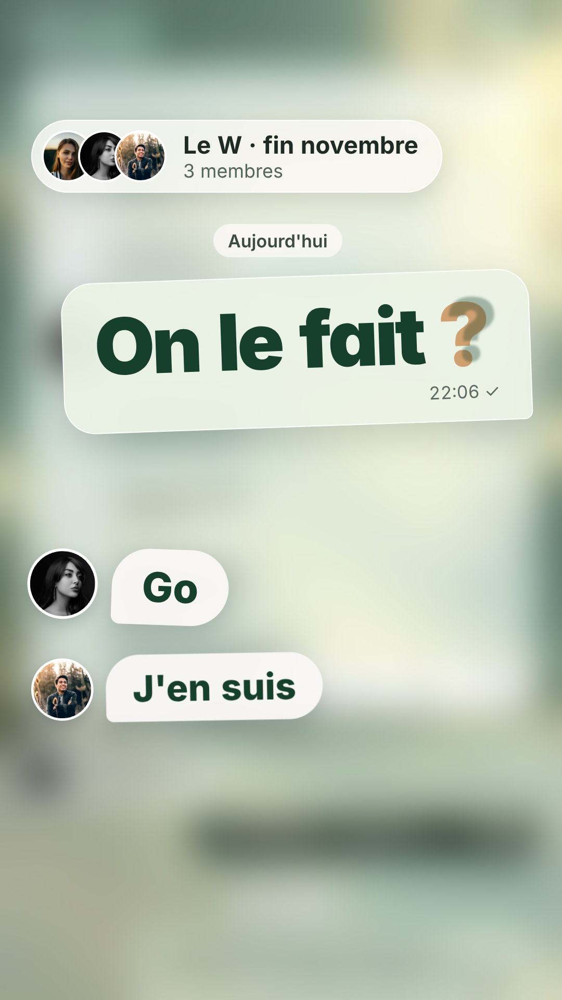

- **Minutage** : 3,879 → 5,172 s · image montrée : 5,00 s (le « ? » vient de claquer)
- **Ce qui bouge** : Messagerie réelle (verre clair sur le fond flouté de l'app). La bulle de Léa claque mot par mot « On / le / fait / ? » (3,879 · 4,202 · 4,526 · 4,849), le « ? » en laiton avec fantôme. Deux réponses arrivent en ressort (« Go » de Camille, « J'en suis ») avec leur avatar. À 5,009 la caméra plonge dans le « ? ».
- **Transition de sortie** : Zoom-through dans le « ? » vers le fond Forest
- **Temps fort musical** : Croches 3,879 → 4,849 ; grosse caisse 5,009 (0,84) ; raccord 5,172
- **Sources** : Reconstruit d'après `messagerie-w.jpg` (bulle, heure « 22:06 ✓ », pilule « Aujourd'hui », fond flouté tiré de la capture). Avatars réels des comptes de démo (Léa Fontaine, Camille Rochat). ★ maquette — à capturer : la conversation de groupe « Le W · fin novembre » et les réponses « Go » / « J'en suis » (en production, Léa écrit seule à Camille : « On fait le W de Torres del Paine fin novembre ? »).

## 06 · Une phrase

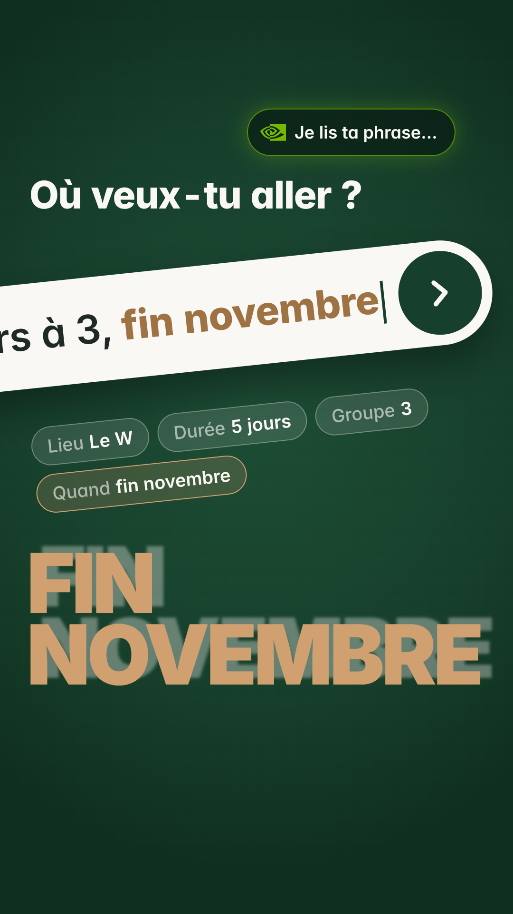

- **Minutage** : 5,172 → 7,112 s · image montrée : 6,79 s (« FIN NOVEMBRE »)
- **Ce qui bouge** : Fond Forest. La barre de saisie réelle du Compas, géante (220 px de haut), traverse le cadre en diagonale (−6°) ; la phrase avance par blocs sur les temps : « LE W » (5,172) · « 5 JOURS » (5,819) · « À 3 » (6,452) · « FIN NOVEMBRE » (6,788). Sous la barre, les pastilles « Voici ce que j'ai compris » s'allument une à une (la dernière en laiton). La pastille NVIDIA « Je lis ta phrase… » s'allume à 6,465. Caméra qui avance en continu.
- **Transition de sortie** : Appui sur la flèche à 7,115 → iris
- **Temps fort musical** : Raccord 5,172 ; 5,819 ; grosse caisse 6,452 (0,91) ; 6,788
- **Sources** : Barre, titre « Où veux-tu aller ? » et texte d'après `compas-phrase.jpg` ; libellé « Je lis ta phrase… » d'après `compas-prep.jpg` ; logo NVIDIA (Simple Icons). Capture réelle possible telle quelle.

## 07 · Plongée et sources

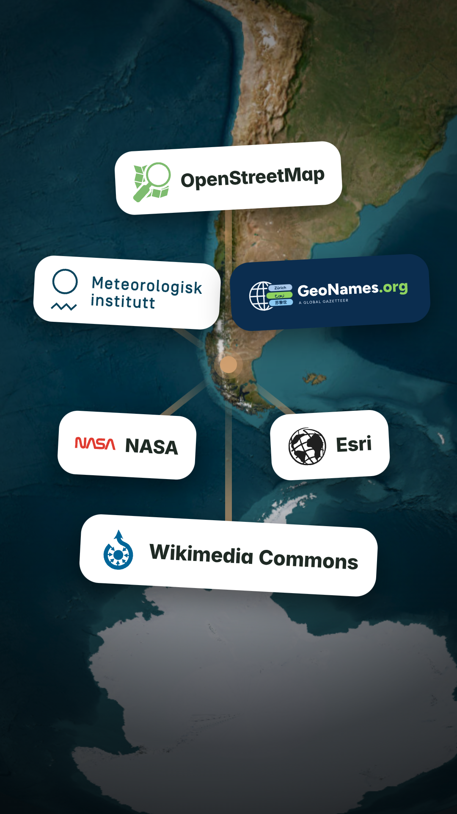

- **Minutage** : 7,112 → 8,405 s · image montrée : 7,80 s (image 2 sur 8 de la sortie des logos)
- **Ce qui bouge** : Iris depuis la flèche, puis vrai globe satellite qui plonge vers la Patagonie (1,3 s, flou de vitesse en trois copies ×1,06 / ×1,14). À 7,759 les six logos réels jaillissent du point de la Patagonie en couronne, avec traînées laiton, et sortent du cadre en 8 images. Le W se trace ensuite (7,9 → 8,4) avec « le W » en Garamond (non visible à cet instant).
- **Transition de sortie** : Dézoom brusque (×3 → ×1, 5 images)
- **Temps fort musical** : Grosse caisse 7,115 (iris) ; mesure 7,759 (explosion des logos)
- **Sources** : Globe rendu depuis les vraies tuiles Esri World Imagery (l'imagerie de l'Explorer), projection orthographique. Logos : OpenStreetMap, NASA, Esri, Wikimedia Commons (Simple Icons) ; MET Norway et GeoNames (SVG officiels de leurs sites), voir `assets/logos/SOURCES.md`.

## 08 · Le voyage se monte

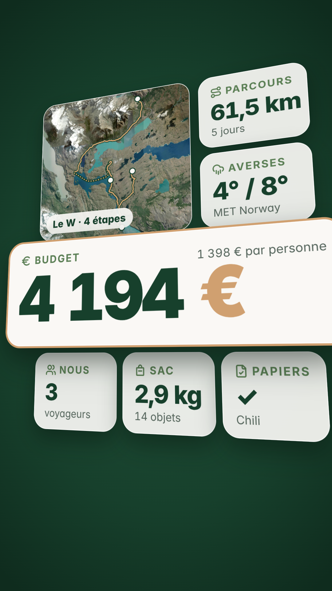

- **Minutage** : 8,405 → 10,345 s · image montrée : 9,05 s (« 4 194 € » claque)
- **Ce qui bouge** : Dézoom brusque : la carte devient une tuile et les autres claquent autour, une par croche, en perspective (rotation Y −16° qui balaye, X 8°) : carte du W, 61,5 km, Averses 4° / 8° (MET Norway), 4 194 € (tuile avancée en Z, bord laiton, compteur qui claque à 9,041), 3 voyageurs, Sac 2,9 kg, Papiers ✓. La caméra survole la mosaïque.
- **Transition de sortie** : Match cut : la tuile « 2,9 kg » devient le fond
- **Temps fort musical** : Croches ; grosse caisse 9,041 (0,92)
- **Sources** : Chiffres réels du voyage de Léa en production : `compas-voyage.jpg` (5 jours, 61,5 km, 1 398 €/pers.), `compas-budget.jpg` (4 194 €), `compas-meteo.jpg` (Averses 4° / 8°, MET Norway), `compas-groupe.jpg` (3 personnes), `compas-sac.jpg` (2,9 kg, 14 objets). Satellite Esri + tracé OSM réel du W (`film-lkdv/boards/w-trace-points.json`).

## 09 · Kit Studio, vraie 3D

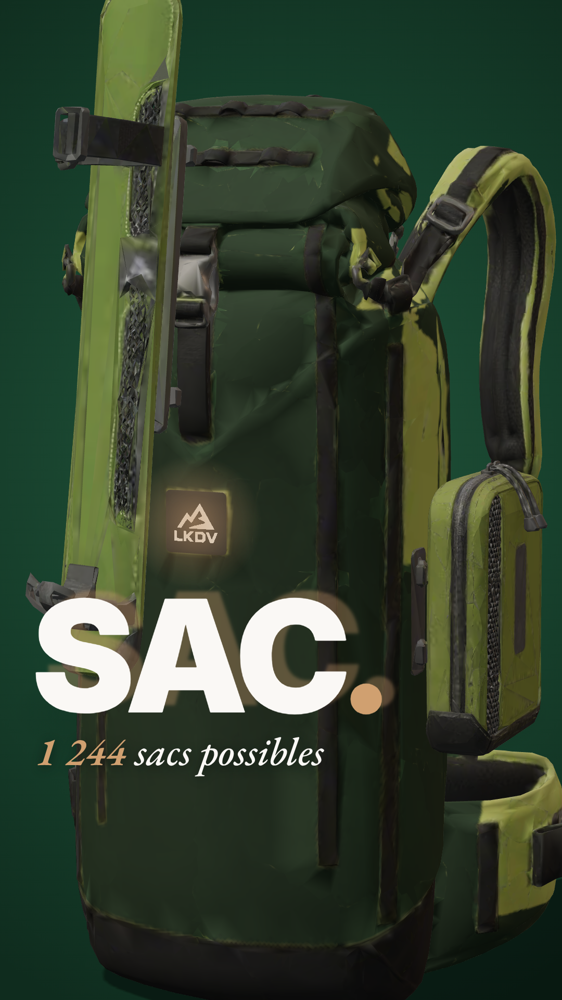

- **Minutage** : 10,345 → 12,931 s · image montrée : 11,55 s (M13 à 0,08 s de son clip)
- **Ce qui bouge** : Vrai sac LKDV ONE 45 L (maillage publié, coloris Forêt) sur fond Forest, orbite qui décélère ; M04 (poche multifonction) déjà clipsée sur le flanc à 10,994 ; M13 (porte-piolets) arrive par l'avant et se clipse à 11,627 ; la pièce cousue LKDV s'allume d'un halo laiton. Le corps passe 45 → 60 L à 12,284. Secousse sur chaque clip. « TON » (10,345) puis « SAC. » (10,668) ; Garamond « 1 244 sacs possibles ».
- **Transition de sortie** : — (le mot « PRÊT. » claque par-dessus)
- **Temps fort musical** : Mesure 10,345 ; grosses caisses 10,994 · 11,627 ; temps 12,284
- **Sources** : Rendu Three.js des `.glb` réels (`lkdv-one-45.glb`, `lkdv-m04.glb`, `lkdv-m13.glb`) avec la teinte d'atlas du Kit Studio (même code que `kit3d-taille.html`). 1 244 = chiffre réel (POTENTIEL-APP §2, ligne 5).

## 10 · PRÊT.

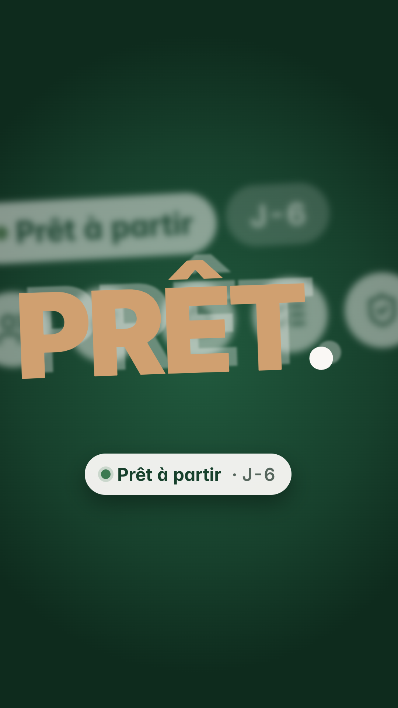

- **Minutage** : 12,931 → 13,577 s · image montrée : 12,96 s (image 1 du claquement)
- **Ce qui bouge** : « PRÊT. » plein écran en laiton (319 px), fantôme Stone, secousse ; derrière, en flou, la vraie pastille « Prêt à partir · J-6 » et les cinq anneaux du voyage ; la pastille nette passe dessous.
- **Transition de sortie** : Implosion (8 images, `expo.in`)
- **Temps fort musical** : Mesure 12,931
- **Sources** : Pastille et anneaux d'après `compas-pret.jpg` (« Prêt à partir », « J-6 », Nous · Budget · Sac · À prévoir · Vérifs).

## 11 · Implosion

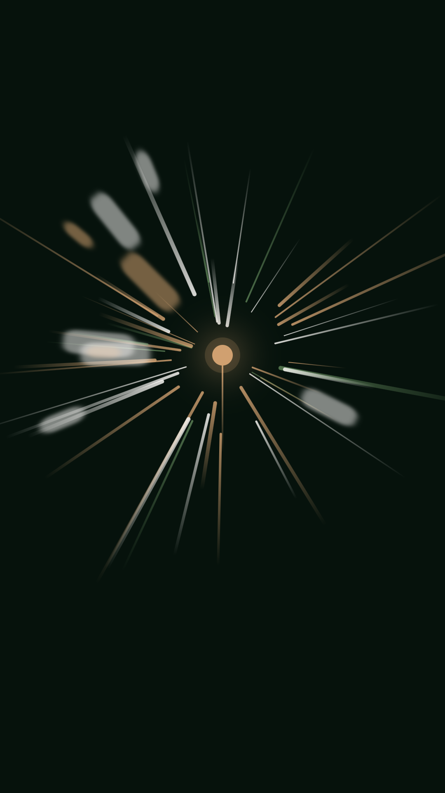

- **Minutage** : 13,577 → 14,224 s · image montrée : 13,85 s (image 7 sur 8 de l'aspiration)
- **Ce qui bouge** : Tout est aspiré en 8 images vers un point laiton (le point GPS) : traînées radiales laiton, sauge et pierre, éclats flous des tuiles. Pendant le quasi-silence (13,955 → 14,255), le point seul, net, et une ligne fine qui naît vers le bas.
- **Transition de sortie** : — (la ligne devient la trace du plan 12)
- **Temps fort musical** : Cassure 13,577 (0,90) ; quasi-silence 13,955
- **Sources** : Graphisme pur (palette de la bible).

## 12 · En route

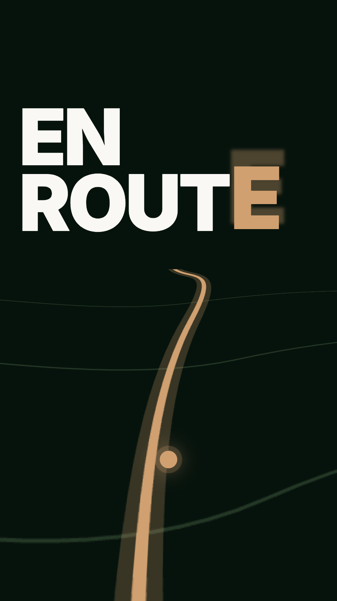

- **Minutage** : 14,224 → 15,517 s · image montrée : 15,36 s (dernier « E » qui claque)
- **Ce qui bouge** : La trace laiton s'allonge dans le noir, sol en perspective (courbes de niveau sauge), la caméra accélère derrière elle. Les lettres claquent en double-croches, crescendo : E-N-R-O-U-T-E (14,870 → 15,355), la dernière en laiton avec fantôme agrandi.
- **Transition de sortie** : Flash laiton 2 images
- **Temps fort musical** : Nappe qui monte ; double-croches 14,870 → 15,355
- **Sources** : Graphisme pur. Proposition : poser « EN » et « ROUTE » sur deux lignes (une seule ligne ne tient pas à 180 px dans la zone sûre).

## 13 · DROP · suivi en direct

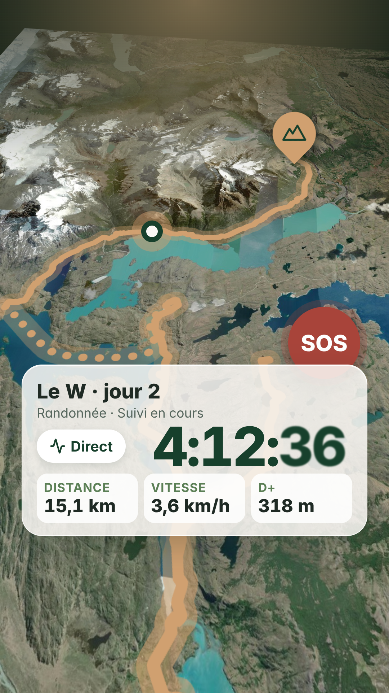

- **Minutage** : 15,517 → 16,810 s · image montrée : 16,20 s
- **Ce qui bouge** : Flash laiton (reste en haut du cadre), puis la carte 3D réelle explose en plein cadre : satellite incliné (X 46°, Z 8°, ×1,3) avec la trace du W qui file, l'épingle-montagne au départ (Refugio Chileno), la position en direct (halo laiton). Les tuiles du suivi en direct claquent : « Direct », chrono qui défile, Distance, Vitesse, D+, et le bouton SOS brique. Rotation Z 8° et zoom ×1,3 sur 16,164.
- **Transition de sortie** : — (les photos tombent sur la carte)
- **Temps fort musical** : DROP 15,518 (1,00) ; grosse caisse 16,164
- **Sources** : Feuille de suivi reconstruite d'après `live.jpg` (« Direct », chrono, DISTANCE / VITESSE / D+, SOS). Satellite Esri + tracé OSM du W. ★ valeurs du suivi simulées (4:12:36, 15,1 km…) : à capturer en mode simulé (`window.__xpSimulateSos = true`), jamais un vrai SOS.

## 14 · Le carnet s'écrit

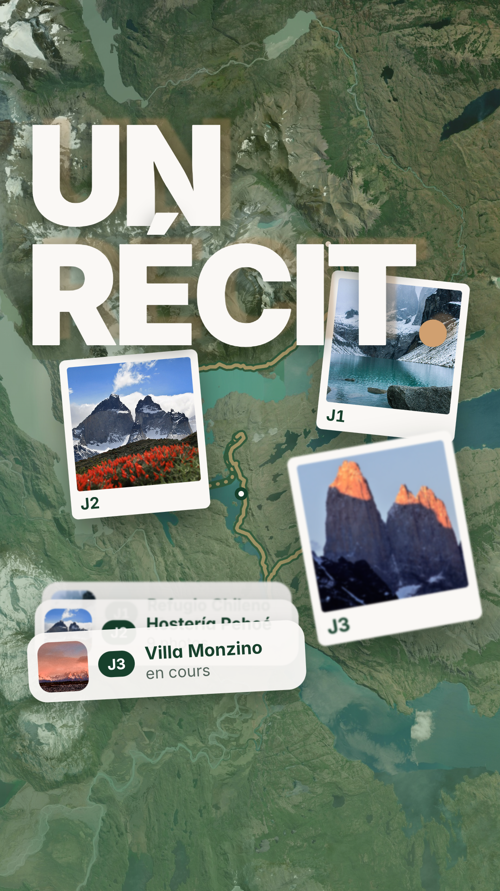

- **Minutage** : 16,810 → 18,103 s · image montrée : 17,46 s (« UN RÉCIT. »)
- **Ce qui bouge** : Vue de dessus, satellite teinté sauge. À chaque grosse caisse une photo tombe sur la carte à sa position (J1 Refugio Chileno, J2 Hostería Pehoé, J3 en chute, agrandie et floue) puis se replie en carte de jour qui s'empile en bas à gauche (J1 · J2 · J3). « UN RÉCIT. » claque à 17,457 (299 px, fantôme laiton).
- **Transition de sortie** : Whip pan vers le haut
- **Temps fort musical** : Grosses caisses 16,799 · 17,461 · 18,103
- **Sources** : Satellite Esri, tracé OSM, étapes réelles du voyage de Léa (Refugio Chileno, Hostería Pehoé, Villa Monzino). Photos Commons. ★ maquette — à capturer : carnet de Léa rempli en route (ellipse assumée : en production les photos de l'activité ne vont pas seules au carnet).

## 15 · Publié

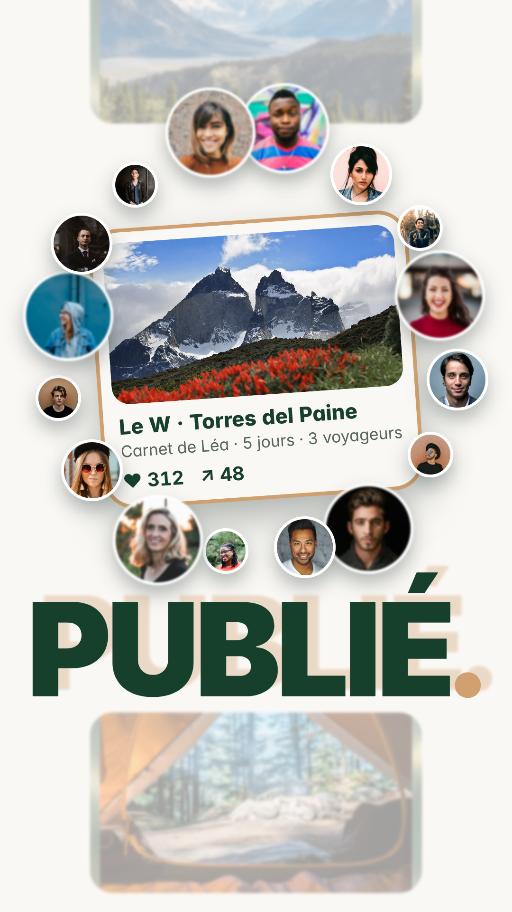

- **Minutage** : 18,103 → 19,396 s · image montrée : 19,30 s (explosion des avatars)
- **Ce qui bouge** : Appui « Publier » à 18,745 ; le carnet de Léa vole dans le fil Communauté (bord laiton), compteurs ♥ et partages qui défilent ; à 19,278, 16 avatars réels explosent du carnet vers la caméra (les plus proches floutés). « PUBLIÉ. » claque (273 px).
- **Transition de sortie** : Zoom-through dans un avatar
- **Temps fort musical** : 18,745 (appui) ; grosse caisse 19,278 (1,00)
- **Sources** : Avatars : photos réelles des comptes de démo (URL Unsplash lues dans `user_profiles`). Posts voisins = captures `feed-3`, `feed-4`. ★ maquette — à capturer : le carnet publié de Léa et ses compteurs (♥ 312, ↗ 48 : chiffres de démo).

## 16 · Bouteille à la mer

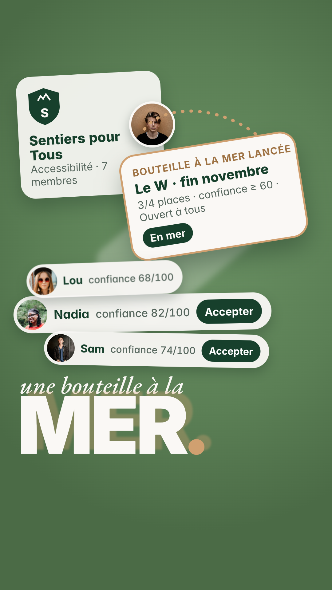

- **Minutage** : 19,396 → 20,690 s · image montrée : 20,40 s (« MER. »)
- **Ce qui bouge** : Fond Sage. Tom, dans un club réel (« Sentiers pour Tous »), lance sa bouteille : la carte-bouteille part en arc (9 images, rotation 360°, traînée pointillée laiton) à 20,047 ; trois candidatures claquent en ressort (Lou, Nadia, Sam, avec « confiance x/100 » et « Accepter »). « BOU-TEILLE À LA MER. » syllabe par syllabe ; l'image montre la dernière syllabe « MER. » avec la phrase en Garamond.
- **Transition de sortie** : Match cut sur le groupe
- **Temps fort musical** : Grosse caisse 20,047 (0,81) ; double-croches
- **Sources** : Tuile club d'après `clubs.jpg` ; textes de la bouteille = vraies chaînes de l'app (`compas-sheets.fr.ts` : « Bouteille à la mer lancée », « En mer », « places · confiance ≥ · Ouvert à tous », « confiance {score}/100 », « Accepter »). ★ maquette — à capturer : compte de Tom, sa bouteille et les trois candidatures.

## 17 · Kit souche : Léa

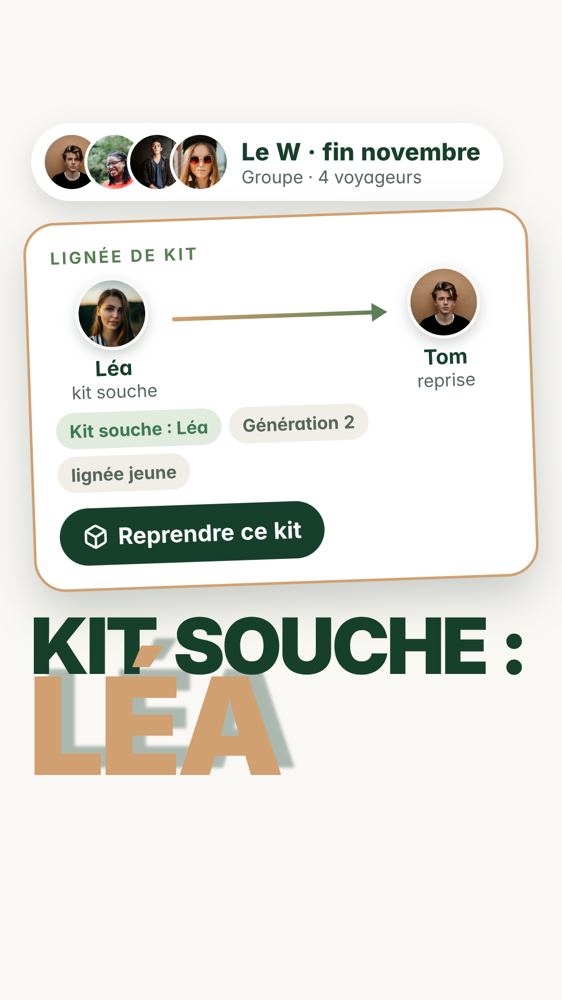

- **Minutage** : 20,690 → 22,629 s · image montrée : 21,40 s
- **Ce qui bouge** : Les trois avatars se soudent au groupe de Tom (« Le W · fin novembre · 4 voyageurs »). La tuile lignée claque à 21,344 : « Lignée de kit », chaîne Léa (kit souche) → Tom (reprise), pastilles « Kit souche : Léa », « Génération 2 », « lignée jeune », bouton « Reprendre ce kit ». Puis replay éclair du Compas (phrase → carte en 6 images, non montré ici).
- **Transition de sortie** : Whip pan à droite
- **Temps fort musical** : Mesure 20,690 ; caisse claire 21,344 (0,85)
- **Sources** : Vocabulaire réel de `KitSheetModal.tsx` (« Lignée de kit », « Génération 2 », statut de lignée). ★ maquette — à capturer : la lignée Léa → Tom (aucune reprise ni génération en base aujourd'hui).

## 18 · La story

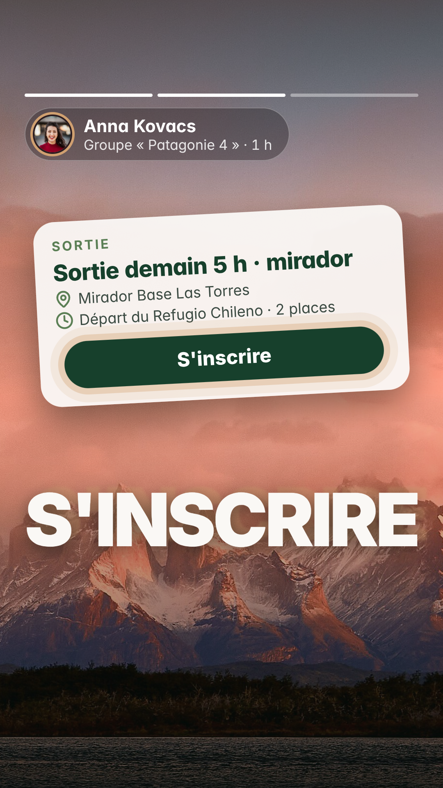

- **Minutage** : 22,629 → 24,565 s · image montrée : 23,95 s (juste après l'appui « S'inscrire »)
- **Ce qui bouge** : La story d'Anna (autre groupe) surgit plein écran, anneau laiton autour de l'avatar, barres de progression. Ticket de sortie : « Sortie demain 5 h · mirador », Mirador Base Las Torres, départ du Refugio Chileno. Appui « S'inscrire » à 23,922 (écrasement 0,96, halo laiton). Ensuite, sur la carte, deux points (Forest et laiton) accélèrent l'un vers l'autre.
- **Transition de sortie** : — (les deux points mènent au plan 19)
- **Temps fort musical** : Mesure 23,276 ; 23,922 (appui)
- **Sources** : Chrome de story d'après `carnet-stories.jpg` ; ticket d'après la fiche sortie (`EventTicket`). Photo Commons (Szekely). ★ maquette — à capturer : la story d'Anna Kovacs (compte de démo) et la sortie.

## 19 · Rencontre

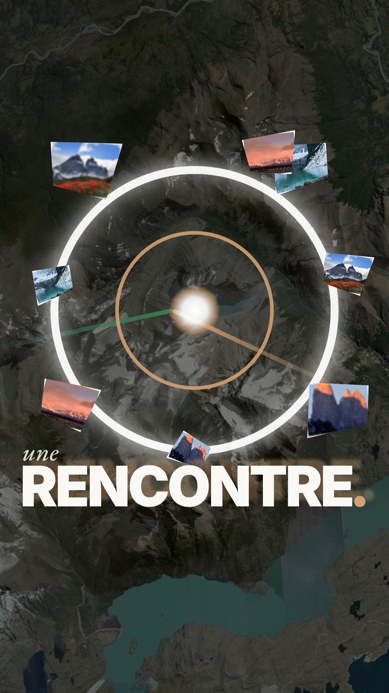

- **Minutage** : 24,565 → 25,862 s · image montrée : 24,58 s (onde de choc, image 1)
- **Ce qui bouge** : Collision des deux points sur le satellite assombri : onde de choc blanche 2 images, anneau laiton intérieur, éclats de photos qui partent vers la caméra, traînées Forest et laiton des deux groupes ; secousse maximale. « UNE » (24,565, Garamond ici) puis « RENCONTRE. » (24,904).
- **Transition de sortie** : Dézoom brutal
- **Temps fort musical** : Caisse claire 24,565 (1,00) ; 24,904 ; 25,290
- **Sources** : Satellite Esri ; photos Commons. « RENCONTRE. » plafonne à 155 px dans la zone sûre (voir corrections).

## 20 · Le monde

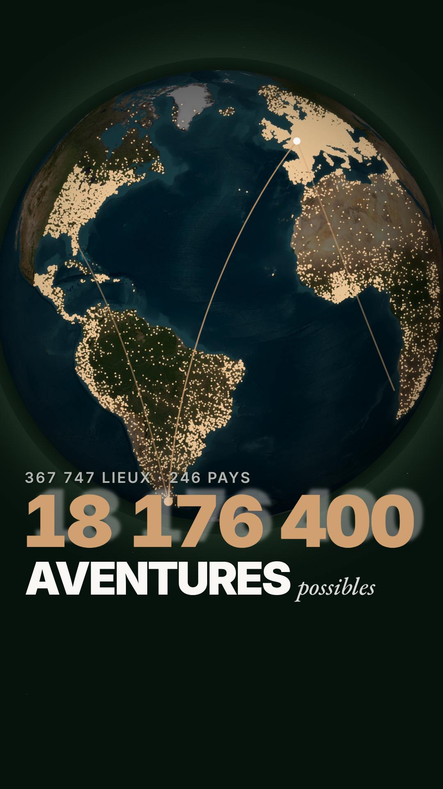

- **Minutage** : 25,862 → 28,140 s · image montrée : 27,85 s (« 18 176 400 »)
- **Ce qui bouge** : Du point de rencontre à la Terre en 0,65 s ; le globe de nuit tourne vite et s'allume des vrais lieux ; arcs laiton de la chaîne (Patagonie → Europe). Les chiffres réels claquent : « 367 747 LIEUX » (26,508) · « 246 PAYS » (27,155) · « 18 176 400 AVENTURES » (27,801, ici, 174 px), les deux premiers restant en rappel discret.
- **Transition de sortie** : — (tout se fige)
- **Temps fort musical** : Cassure 26,508 (0,85) ; 27,155 ; caisse claire 27,801 (0,83)
- **Sources** : Globe Esri. Points = vraie répartition des 367 747 lieux GeoNames de `geo_places` (agrégée par cases de 4°, ~18 700 points dessinés pour l'hémisphère visible). Chiffres réels (POTENTIEL-APP §2-3).

## 21 · Silence

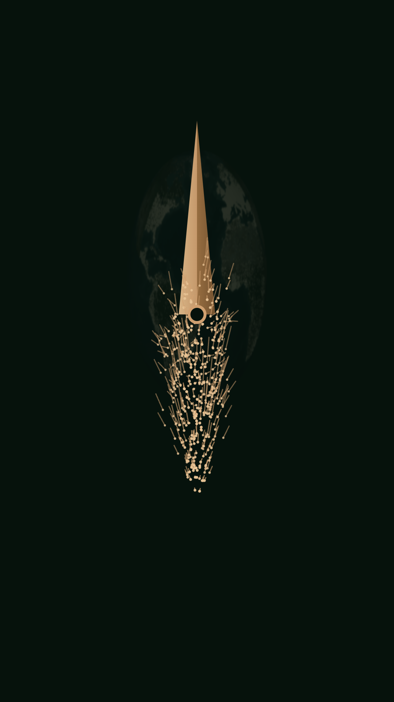

- **Minutage** : 28,140 → 28,448 s · image montrée : 28,30 s
- **Ce qui bouge** : Seul arrêt du film : tout se fige, puis les points des lieux se replient en aiguille de boussole laiton (la moitié nord déjà formée, la moitié sud faite de particules en vol) ; le globe ne reste qu'en ombre.
- **Transition de sortie** : — (l'aiguille claque sur l'impact)
- **Temps fort musical** : Silence 28,140 → 28,447
- **Sources** : Aiguille dessinée d'après les pointes de la rose des vents du badge LKDV (laiton / bronze).

## 22 · Impact final

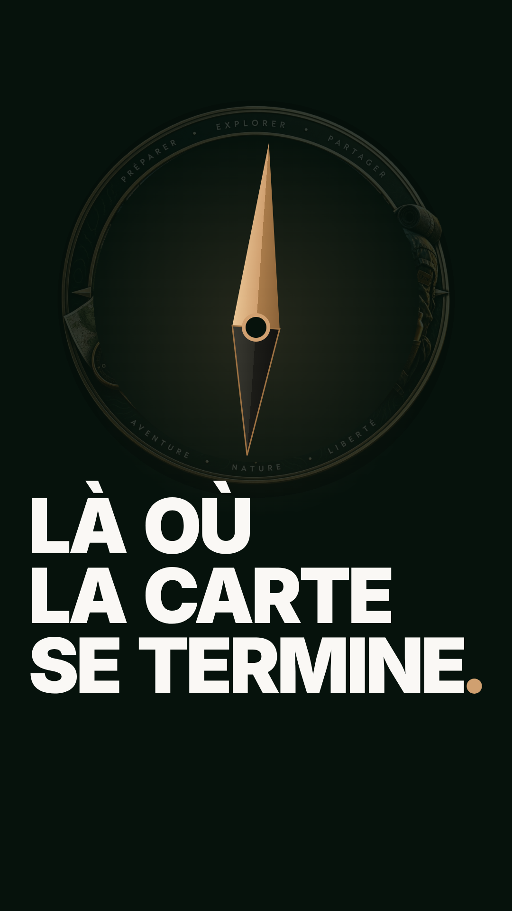

- **Minutage** : 28,448 → 30,000 s · image montrée : 28,80 s (anneau encore allumé, mots posés)
- **Ce qui bouge** : L'aiguille claque et se cale (ressort, 8 images, légère surrotation 4°), l'anneau du badge s'allume 0,4 s en laiton à 18 % ; « LÀ OÙ LA CARTE » (28,448) puis « SE TERMINE. » (28,771) claquent et tiennent ≥ 1,2 s ; caméra qui pousse de 2 % jusqu'à 30,000.
- **Transition de sortie** : Fin à 30,000 s (la réverbération s'éteint)
- **Temps fort musical** : IMPACT FINAL 28,448 (1,00) ; 28,771
- **Sources** : Anneau extrait de `public/logo.png` (couronne extérieure seulement, jamais le badge entier). Phrase = promesse réelle de la page d'accueil (« Là où la carte se termine. »).

## Contrôle qualité (fait image par image)

- **Zone sûre** : tous les plans relus avec un cadre 60–1020 × 220–1500 superposé. Corrigés : p01 (« POST. » descendait à 1 676 px → carte raccourcie, mot remonté), p03 (« +2 900 » cassait sur deux lignes, Garamond et « 5 JOURS » chevauchaient la tuile Équipage → tuiles plus basses, textes descendus), p07 (couronne de logos décalée de 280 px à droite, NASA / Esri / Commons coupés → transformation corrigée, couronne recentrée sur la Patagonie), p09 (« 1 244 sacs possibles » sur le porte-piolets → passé sous « SAC. »), p12 (le « E » laiton sortait à droite → 250 px), p14 (mot et polaroïds superposés, carte qui ne couvrait pas le haut → carte recadrée, photos replacées), p15 (avatars sur le texte du carnet → couronne élargie), p16 (bouteille qui chevauchait les candidatures et sortait à droite → recadrée), p17 (« KIT SOUCHE : » collé à la tuile → descendu), p22 (« LÀ OÙ » touchait la pointe de l'aiguille → aiguille raccourcie).
- **Lisibilité** : aucun texte utile sous 34 px (corrigés : libellés du suivi en direct p13 30 → 34 px ; candidature floue p16 ramenée à ×0,94). Débordements de tuiles corrigés en p08 (« 61,5 km » et « MET Norway » tronqués), p05 (« ? » renvoyé à la ligne), p18 (titre de sortie sur deux lignes).
- **Logos** : MET Norway était invisible (mauvaise transformation) et le logo GeoNames officiel « dark » a un texte clair → posé sur une pastille bleu nuit.
- **3D** : la pièce cousue LKDV est cachée par le porte-piolets M13 une fois clipsé (le M13 se pose exactement dessus, ancre façade) ; l'image montre donc M13 à 0,08 s de son clip, pièce encore visible et allumée (voir corrections de la bible).
- **Cohérence** : avatar de groupe Unsplash (photo à plusieurs) écarté de la liste des avatars ; noms des candidats (Lou, Nadia, Sam) distincts de l'équipage de Maya (Inès, Hugo) ; tous les chiffres hors ★ relus sur les captures (4 194 €, 1 398 €, 61,5 km, 2,9 kg, 14 objets, 3 personnes, Averses 4° / 8°, J-6, 1 244, 367 747, 246, 18 176 400).
- **Variété** : 22 compositions différentes ; jamais deux fonds ni deux gabarits identiques de suite (Stone → photo → Forest → satellite → nuit), mot à gauche / en haut / en bas selon les plans.

## Propositions de corrections de la bible

1. **Pièce LKDV et porte-piolets (plan 09)** : le M13 se clipse exactement sur la pièce cousue (même ancre façade, y 0,34–0,38 m) et la masque. Proposition : faire le gros plan sur la pièce **à 10,994 s** (pendant que M04 se clipse sur le flanc), et clipser M13 à 11,627 s en recadrant large ; ou poser un autre module que M13 sur la façade.
2. **Mots trop longs pour 180 px dans la zone sûre** : « NOVEMBRE » (174 px), « RENCONTRE. » (155 px), « S'INSCRIRE » (179 px), « KIT SOUCHE : » (149 px), « SE TERMINE. » (160 px), « 18 176 400 » (174 px). Proposition : accepter 150–180 px pour ces mots (ils tiennent à 90 % de la largeur), ou une variante condensée (étirement vertical ×1,3), plutôt que de sortir de la zone sûre.
3. **Phrase finale** : « LÀ OÙ LA CARTE » ne tient pas sur une ligne ; proposition : trois lignes « LÀ OÙ / LA CARTE / SE TERMINE. » à taille unique (160 px), comme sur l'image.
4. **« 18 176 400 AVENTURES »** : ce sont des combinaisons de réglages, pas des voyages. Proposition : garder le Garamond « possibles » (sur l'image) ou « façons de régler une aventure » pour rester défendable (POTENTIEL-APP §2).
5. **Bouteille à la mer « dans un club »** : dans l'app la bouteille se lance depuis le Compas (tiroir Nous) et s'affiche dans **la communauté du pays**, pas dans un club. Proposition : montrer Tom dans son club (lieu de vie) mais la bouteille avec son vrai libellé « Visible dans la communauté du pays ».
6. **Messagerie (plan 05)** : en production, la conversation est Léa → Camille seule. Les réponses « Go » / « J'en suis » supposent un groupe de discussion : à créer (★).
7. **« BOU-TEILLE À LA MER. » syllabe par syllabe** : illisible en image fixe et risqué en 1,3 s. Proposition : « MER. » en claque et « une bouteille à la » en Garamond (comme sur l'image).
8. **« EN ROUTE »** : sur une ligne il plafonne à 175 px ; deux lignes « EN / ROUTE » à 250 px.

## Éléments ★ à créer dans l'app (compte de démo)

Carnet « Le W » de Maya Roussel (photos Commons créditées, `assets/photos/CREDITS.md`) et son post ; verdicts de son kit ; groupe de discussion « Le W · fin novembre » et réponses ; compte de Tom, son club, sa bouteille et trois candidatures ; lignée Léa → Tom (génération 2) ; carnet publié de Léa ; story d'Anna Kovacs et sortie « demain 5 h · mirador » ; séance de suivi simulée sur le W.
