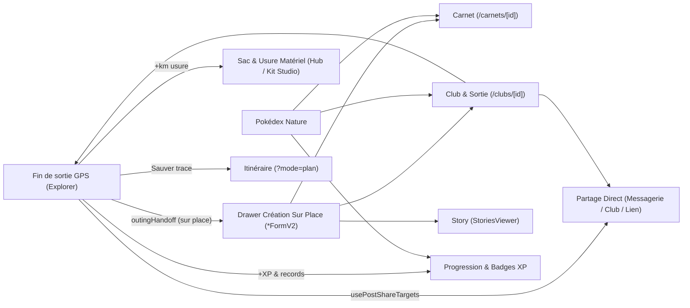

# CAPABILITY_GRAPH — Graphe d'Interconnexion Systémique LKDV

> Chaque événement majeur dans LKDV doit irriguer l'ensemble de l'écosystème. **Privilégier le montage d'un drawer sur place** plutôt qu'une redirection qui casse le contexte utilisateur.

---

## Matrice Événement → Interconnexions Obligatoires

| Événement Source | Actions à proposer SUR PLACE (Drawer) | Ponts de Données & Effets Secondaires |
| :--- | :--- | :--- |
| **1. Fin de sortie GPS** (`ExplorerSummarySheet`) | • **Créer un Post** (`PostFormV2` en drawer sur Explorer) • **Créer une Story** (`StoryFormV2` en drawer sur Explorer) • **Créer / Attacher à un Carnet** (`CarnetFormV2`) • **Partager à un Club ou une Discussion** (`PostSharePanel` / `usePostShareTargets`) • **Ouvrir Analyse Avancée** (`SummaryExpertAnalysisSubDrawer`) | • Auto-remplissage complet via `outingHandoff.ts` (distance, D+, durée, GPX, lieu, météo, RPE, notes) • Mise à jour usure matériel (`user_gear` / `WearBar`) • Attribution `+XP`, badges & détection segments (`/api/segments/detect`) • Sauvegarde en itinéraire (`/explorer?mode=plan`) |
| **2. Création dans un Carnet** (`/carnets/[id]`) | • `CarnetCommunityCreateBridge` : monter **Post**, **Story**, **Note vocale**, **Rencontre**, **Espèce Pokédex**, **Incident terrain** directement sur le carnet | • Lie automatiquement `carnet_id` + coordonnée GPS du jour (`J1/J2`) • Alimente le fil du carnet + `CarnetMap` + Pokédex global |
| **3. Activité dans un Club** (`/clubs/[id]`) | • `ClubCreateDrawerBody` / `ClubDrawerHost` : **Sortie collective**, **Post club**, **Story/Highlight**, **Kit standard**, **Salon discussion** | • Synchronisation 2 voies `ClubInlineFeed` ↔ `ClubMap` (Story Bloom, pins sorties, membres live) • RSVP sortie (`club_event_participants`) + notification Messagerie |
| **4. Découverte Faune / Flore** (Explorer / Carnet / Club) | • `CarnetSpeciesCreatePane` / fiche Pokédex sur place | • Enregistre dans `pokedex_*`, ajoute pin 3D sur la carte, attribue `+XP`, partageable en Story/Post |
| **5. Modification Sac / Kit** (`Kit Studio` / `Hub`) | • Partager le kit en Post (`KitFormV2`) ou dans un Club (`ClubCoffreDrawerBody`), lier à une Sortie/Carnet | • Calcul poids total + répartition + suivi usure (`WearBar`) + liens boutique (`ProductGlassCard`) |
| **6. Interaction sur un Post** (Communauté / Club / Carnet / Reels) | • Swipe ou tap → `FreedomCommentsDrawer` (Commentaires) ou `PostSharePanel` / `FreedomShareDrawer` (envoi Messagerie, Club, copie lien) | • Même composant & même historique partout, jamais de duplication de logique |
